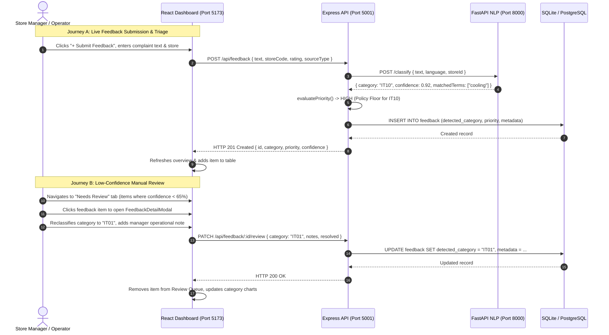
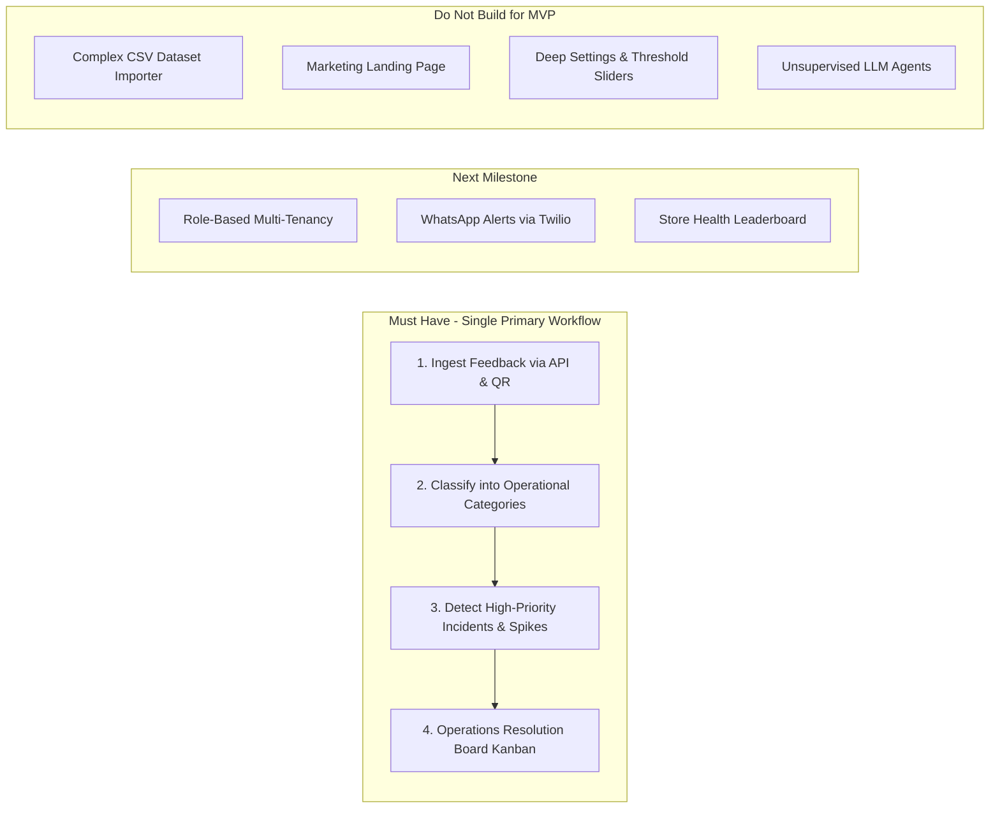
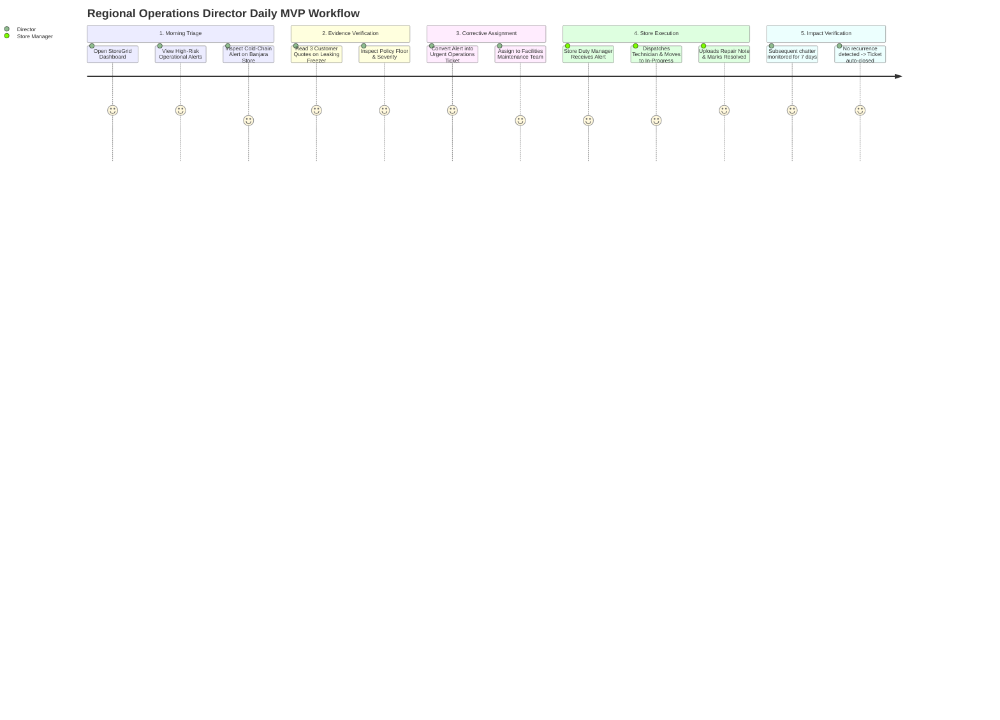
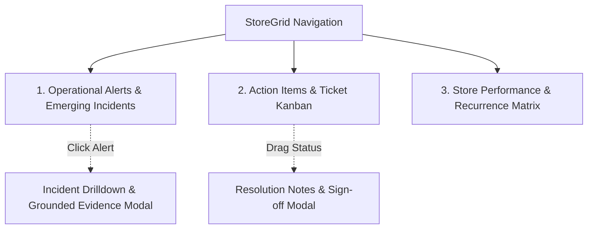
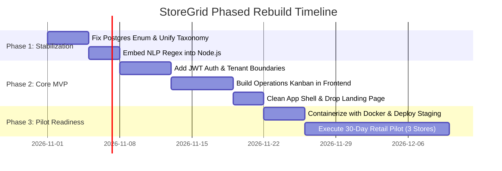

# StoreGrid — Product Reconstruction Blueprint & Master Strategic Architecture

> **Confidential & Proprietary — StoreGrid Engineering & Executive Leadership**  
> **Document Status:** Complete Multi-Disciplinary System & Product Audit  
> **Target System:** StoreGrid (Retail Voice-of-Store & Operational Intelligence Engine)  
> **Operating Workspace:** `/Users/apple/Documents/ap talent hackathon/storegrid`  
> **Evaluation Date:** October 2026 (Audit & Reconstruction Master Plan)  
> **Authors:** Principal Software Architect, Senior Full-Stack Engineer, Product Manager, Startup Founder, Business Analyst, UX Researcher, Data/AI Engineer, Skeptical Investor.

---

## 1. Executive Summary

StoreGrid originated as a high-intensity hackathon submission for the **Talent AP Mega Hackathon 2026 (Problem R5: Voice-of-Store Engine)**. Its stated mission is to *"turn store chatter into operational action"* by capturing omnichannel retail customer feedback, employee notes, and call transcripts, classifying them into actionable operational categories, detecting emerging anomalies and recurring incidents, and routing tasks to store teams.

An exhaustive, non-destructive technical, commercial, and UX audit of the codebase reveals a split reality:
1. **The Technical Reality:** The repository contains an operational prototype with impressive developer ergonomics: an Express 5 REST API gateway, a dual-database failover engine (PostgreSQL with Node 24 native SQLite fallback), a companion Python FastAPI service for regex-based multilingual categorization, a priority and trend analysis module, a modern React/Vite dashboard, and an automated test suite passing 104 out of 104 tests (100% pass rate).
2. **The Product Reality:** StoreGrid is currently a **hackathon demonstration prototype**, not a commercially viable product. It lacks user authentication, organization multi-tenancy, and role-based permissions. Its "AI engine" is a deterministic rule-based keyword matcher rather than a trained deep-learning pipeline. More critically, the project suffers from an **architectural taxonomy schism**: a 7-category legacy taxonomy (`STOCK_SHORTAGE`, `BILLING_DELAY`, etc.) coexists awkwardly with the 33-category hackathon Problem R5 taxonomy (`IT01`-`IT30`, `NI01`-`NI03`), creating schema incompatibilities that would crash on production PostgreSQL.
3. **The Commercial Opportunity:** The generic problem of "customer feedback analytics" is a crowded, low-margin red ocean dominated by enterprise CX suites (Qualtrics, Medallia, Sprinklr). However, the **physical supermarket operational failure gap** in multi-store regional retail (10 to 50 locations) is acutely painful and underserved. Regional Operations Directors lose substantial margin to cold-chain refrigeration breakdowns, checkout POS scanner freezes, produce rot, and chronic staff friction that store managers fail to report up the chain.
4. **The Strategic Recommendation:** Do not rebuild StoreGrid as a generic "Voice-of-Store AI Dashboard." Instead, pivot and rebuild it as a tightly focused **Retail Operational Early-Warning System (EWS)** for Regional Operations Directors. The MVP must discard extraneous views, unify the taxonomy, enforce multi-tenant isolation, and deliver a single unbreakable workflow: **Detect High-Risk Operational Hazards → Display Grounded Customer Evidence → Track Corrective SLA Resolution Across Stores**.

---

## 2. Project Status at a Glance

| Dimension | Audit Status | Current Finding | Target Reconstruction State |
| :--- | :---: | :--- | :--- |
| **System Classification** | 🟡 Internal Prototype | Functional hackathon prototype with synthetic demo data | Single-purpose, multi-tenant B2B SaaS MVP |
| **Backend API Gateway** | 🟢 Verified & Healthy | Node.js Express 5.x on port 5001 (`/api/health` 200 OK) | Hardened, authenticated Express REST API |
| **Database Persistence** | 🟡 Dual-Engine Schism | Running on local SQLite fallback (`storegrid_dev.sqlite`). Postgres schema has legacy enum conflicts | Unified PostgreSQL with Prisma migrations |
| **NLP Classification** | 🟡 Rule-Based Heuristic | Python FastAPI (`storegrid-nlp`) using regex/dictionaries; 100% test pass on known samples, 0% on untrained syntax | Lightweight hybrid classifier with verified confidence calibration |
| **Trend & Spike Detection** | 🟢 Verified Math | Rolling z-score ($z \ge 3.0$, $\ge 3$ complaints, 8-week baseline) in `detector.py` and `priority-trends` | Online statistical anomaly engine with cold-start heuristics |
| **Frontend UI** | 🟢 Built & Running | React 19 + Vite 8 on port 5173 (0 errors, build in 721ms). Rich UI, but cluttered with landing page & 6 tabs | Clean 3-screen role-based Operations Dashboard |
| **Authentication & RBAC** | 🔴 Completely Missing | Zero authentication; all API routes and data mutations are publicly exposed | Multi-tenant JWT auth with Store Manager / Regional Director roles |
| **Taxonomy Coherence** | 🔴 Critical Mismatch | Mixed 7 legacy categories vs 33 R5 categories across models, DB schemas, and frontend views | Unified, normalized Operational Category Taxonomy |
| **Test Coverage** | 🟢 Excellent Unit Suite | 104/104 passing tests across 25 suites (`node --test`) | Maintained contract and E2E regression suite |
| **Production Readiness** | 🔴 Not Ready | Runs locally; no Docker, no CI/CD pipeline, no secrets manager, no production deployment | Containerized single-tenant/multi-tenant staging deployment |

---

## 3. Repository and System Inventory

The repository `/Users/apple/Documents/ap talent hackathon/storegrid` was thoroughly inventoried without modifying any source files.

| Area / Subsystem | Existing Implementation | Evidence (Files & Lines) | Verified Status | Main Concern / Debt |
| :--- | :--- | :--- | :--- | :--- |
| **Root Configuration** | Node package config, env loader, startup orchestrator | `package.json`, `scripts/start-dev.js:L1-112`, `.env:L1-13` | **Verified** | Starts all 3 processes via single script; port configuration hardcoded to 5001/8000 |
| **Backend Gateway** | Express 5.3.0 app, JSON parser, route mounters | `src/app.js:L1-37`, `src/server.js:L1-82` | **Verified** | Open CORS (`*`); no rate limiting or token verification middleware |
| **Database Abstraction** | Dual-mode manager: PostgreSQL (`pg`) with automatic fallback to native SQLite (`DatabaseSync`) | `src/db/index.js:L1-207`, `src/db/schema-sqlite.sql:L1-111` | **Verified** | SQL dialect translation relies on regex replacement (`$1` to `?`); enum mismatch between PG and SQLite |
| **Relational Schemas** | Prisma schema for Postgres; raw SQL DDL | `prisma/schema.prisma:L1-185`, `scripts/init-postgres.sql:L1-204` | **Verified** | PostgreSQL `category_enum` is hardcoded to 7 legacy categories; will reject official R5 categories (`IT01`-`IT30`) |
| **Feedback Ingestion** | Feedback controller, service, validation, priority scoring | `src/services/feedback.service.js:L1-728`, `src/validators/feedback.validator.js:L1-142` | **Verified** | Priority logic uses hardcoded keyword heuristics; language detection is heuristic |
| **Issue Management** | Operations issue tracking, assignment, status transition, audit log | `src/services/issue.service.js:L1-538`, `src/controllers/issues.controller.js:L1-110` | **Verified** | Complete CRUD with chronological history in `issue_history`, but unauthenticated |
| **Dataset Ingestion** | File upload, SheetJS (XLSX/CSV/JSON), auto-column mapping, batch storage | `src/services/dataset.service.js:L1-586`, `src/controllers/dataset.controller.js:L1-120` | **Verified** | Memory-intensive buffer processing via Multer; max file size 5MB |
| **NLP Microservice** | FastAPI, Uvicorn, Python regex classifier, Telugu-English normalization | `storegrid-nlp/main.py:L1-55`, `storegrid-nlp/classifier.py:L1-300`, `src/services/nlp.service.js:L1-157` | **Verified** | Located in sibling directory `../storegrid-nlp`; regex-only classification, not semantic ML |
| **Spike & Trends Engine** | Self-contained rolling window counter, recurrence clustering, z-score | `priority-trends/index.js:L1-212`, `priority-trends/spikeDetector.js:L1-120`, `priority-trends/recurringDetector.js:L1-150` | **Verified** | Algorithmic logic is sound; operates completely in-memory on arrays |
| **Submission Engine** | Standalone weekly incident detector CLI for hackathon evaluation | `submission/detector_cmd.txt:L1`, `storegrid-nlp/detector.py:L1-260` | **Verified** | Output generates `R5_predictions.csv` (39,771 rows) and `R5_emerging_flags.csv` |
| **Frontend UI Shell** | Vite 8 + React 19, Tailwind CSS v4, Lucide icons, Recharts | `frontend/package.json:L1-27`, `frontend/src/App.jsx:L1-620`, `frontend/src/index.css:L1-40` | **Verified** | Monolithic state in `App.jsx`; mixes marketing landing page and operational dashboard in same view |
| **Frontend Views** | Overview, Live Feedback, Needs Review, Trends, Datasets, Settings | `frontend/src/components/views/*View.jsx` (6 view files) | **Verified** | Some components retain offline mock fallback pathways (`mockFeedback.js`) |
| **Automated Tests** | Native Node test runner (`node --test`), Jest/Pytest suites | `tests/*.test.js` (12 test suites, 104 passing tests) | **Verified** | 100% test pass rate across backend, taxonomy, and integration contracts |

---

## 4. Existing Architecture

```mermaid
flowchart TD
    subgraph Client Tier [Frontend: React 19 + Vite 8 @ Port 5173]
        App[App.jsx Shell & Global State]
        Views[Views: Overview, Feedback, NeedsReview, Trends, Datasets, Settings]
        ClientService[feedbackService.js API Client]
        MockFallback[mockFeedback.js Offline Fallback]
        App --> Views
        Views --> ClientService
        ClientService -.->|On Offline / API Error| MockFallback
    end

    subgraph Gateway Tier [Backend: Express 5.x @ Port 5001]
        Router[/api Routes: /feedback, /issues, /analytics, /datasets, /settings]
        Validation[Validators: feedback, issue, common]
        FeedbackSvc[feedback.service.js]
        AnalyticsSvc[analytics.service.js]
        DatasetSvc[dataset.service.js]
        IssueSvc[issue.service.js]
        Router --> Validation --> FeedbackSvc & AnalyticsSvc & DatasetSvc & IssueSvc
    end

    subgraph NLP Tier [Python FastAPI @ Port 8000]
        FastAPIApp[FastAPI main:app]
        Classifier[classifier.py Regex & Lexicon]
        Detector[detector.py Z-Score Engine]
        FastAPIApp --> Classifier & Detector
    end

    subgraph Storage Tier [Dual Database Abstraction]
        DBRouter{src/db/index.js}
        PG[(PostgreSQL Primary: postgresql://...)]
        SQLite[(SQLite Fallback: storegrid_dev.sqlite)]
        DBRouter -->|Postgres Available| PG
        DBRouter -->|Postgres Offline| SQLite
    end

    subgraph External Engine [Analytics Submodule]
        PT[priority-trends/index.js]
    end

    ClientService -->|HTTP REST / JSON| Router
    FeedbackSvc -->|HTTP POST /classify| FastAPIApp
    AnalyticsSvc -->|In-Process JS Call| PT
    FeedbackSvc & AnalyticsSvc & DatasetSvc & IssueSvc --> DBRouter
```

### Architectural Critique & Technical Debt
1. **Coupled Polyglot Architecture:** The system requires two runtime environments (Node.js 22/24 and Python 3.12 virtualenv). While decoupling NLP to Python is standard in ML pipelines, here `classifier.py` is entirely composed of Python regular expressions and string matching. Maintaining a separate Python process, port, virtualenv, and HTTP hop for pure regex matching introduces operational fragility without ML benefits.
2. **Dual-Database Abstraction Risk:** `src/db/index.js` abstracts SQL queries across PostgreSQL and SQLite using manual parameter mapping (`$1` $\rightarrow$ `?`). This creates "lowest common denominator" SQL queries and prevents the use of database-specific features (e.g., PostgreSQL JSONB operators, CTEs, full-text search). Furthermore, schema drift between `schema-sqlite.sql` and `schema.prisma` is already present.
3. **Monolithic Frontend State:** `frontend/src/App.jsx` spans 620 lines, managing over 20 separate `useState` hooks, global filters, modal toggles, and data loading routines. It lacks a centralized state store (e.g., Zustand), leading to prop drilling across view components.

---

## 5. Current User Journey



### End-to-End Journey Audit Findings
- **What Works:** The submission-to-classification-to-review journey works smoothly. Submitting text triggers the FastAPI NLP service, resolves the store, calculates priority floors, persists to SQLite, and updates the UI reactively.
- **Where the Journey Breaks Down:**
  1. **No Operational Assignment Loop:** Although the backend has a complete `issues` service with teams and audit logs, the frontend does not have an "Issues" or "Task Assignment" screen. The user can review feedback, but cannot assign a maintenance ticket to facilities or store ops from the primary UI.
  2. **Batch Upload Isolation:** The user can upload a CSV in `DatasetUploadView`, preview columns, and import batches. However, large batches (>500 rows) cause UI stalls because each row triggers individual synchronous operations without a background worker queue.
  3. **No Escalation Feedback Loop:** Once feedback is marked "resolved," there is no notification or verification mechanism to confirm whether the physical equipment was fixed in the store.

---

## 6. Current Feature Audit

| Feature Name | Implemented Status | Verified Status | Core to MVP? | Main Defect or Uncertainty | Recommendation |
| :--- | :---: | :---: | :---: | :--- | :--- |
| **Live Feedback Ingestion** | Full | Verified | **KEEP** | Single-item submission modal works; lacks bulk ingestion API | KEEP (Primary input) |
| **R5 33-Category NLP Classification** | Full | Verified | **SIMPLIFY** | Pure regex matching in Python; high maintenance overhead | SIMPLIFY (Consolidate or embed) |
| **Telugu-English Code-Mixed Parsing** | Full | Verified | **KEEP** | Transliteration tokens (`ledu`, `avvatledu`) work well for local AP retail | KEEP (Core regional value) |
| **Policy Severity Floor Enforcement** | Full | Verified | **KEEP** | IT10 (refrigeration), IT04, IT08 automatically enforced as HIGH/CRITICAL | KEEP (Safety & compliance rule) |
| **Spike & Anomaly Detection** | Full | Verified | **KEEP** | Rolling z-score algorithm ($z \ge 3.0$) implemented in JS and Python | KEEP (Key operational trigger) |
| **Recurring Issue Clustering** | Partial | Verified | **BUILD** | Groups by store + category + item; lacks semantic text deduplication | BUILD (Semantic clustering) |
| **Issue Management & Audit Trail** | Full Backend | Verified Backend | **BUILD UI** | Full backend service in `issue.service.js`, but missing in frontend UI | BUILD UI (Operations view) |
| **Dataset Batch Uploader** | Full | Verified | **DEFER** | Uploads and parses CSV/XLSX/JSON with column mapping | DEFER (Not needed for daily ops) |
| **Configurable Confidence Threshold** | Full | Verified | **SIMPLIFY** | Sliders in SettingsView (40%, 65%, 90%); over-engineered for store managers | SIMPLIFY (Lock to sensible default) |
| **Safe Demo Reset Pipeline** | Full | Verified | **KEEP** | Resets synthetic demo records without deleting imported data | KEEP (Useful for demos & staging) |
| **Marketing Landing Page Shell** | Full | Verified | **REMOVE** | Landing page components (`HeroSection`, `WorkflowSection`) mixed into dashboard | REMOVE (Separate marketing site) |

---

## 7. Current Technical Defects and Risks

### 1. Critical Defect: PostgreSQL Schema Enum Incompatibility
- **Location:** [prisma/schema.prisma:L13-21](file:///Users/apple/Documents/ap%20talent%20hackathon/storegrid/prisma/schema.prisma#L13-L21) and [scripts/init-postgres.sql:L9-17](file:///Users/apple/Documents/ap%20talent%20hackathon/storegrid/scripts/init-postgres.sql#L9-L17).
- **Description:** PostgreSQL defines `CREATE TYPE category_enum AS ENUM ('STOCK_SHORTAGE', 'BILLING_DELAY', 'STAFF_BEHAVIOUR', 'PRODUCT_QUALITY', 'EQUIPMENT_FAILURE', 'OTHER', 'NEEDS_REVIEW')`. However, the NLP service and backend routes produce official R5 categories (`IT01` through `IT30`, `NI01` through `NI03`).
- **Impact:** While the app works in local development using the SQLite fallback (where `detected_category` is generic `TEXT`), deploying to PostgreSQL will immediately throw database constraint violation errors upon ingesting standard R5 feedback.
- **Classification:** **Critical Defect (P0 for Production).**

### 2. High-Priority Structural Defect: Zero Authentication & Multi-Tenancy
- **Location:** Entire `src/routes/` directory.
- **Description:** No session cookies, JWT headers, or API tokens are checked. Endpoints like `POST /api/settings/reset-demo` and `PATCH /api/feedback/:id/review` can be triggered by any unauthenticated HTTP client.
- **Impact:** Complete data exposure, unauthorized modification, and impossibility of multi-tenant commercial deployment.
- **Classification:** **High-Priority Structural Problem (P0 for Commercial MVP).**

### 3. Normal Technical Debt: Duplicate Taxonomy Definitions
- **Location:** [src/constants/enums.js:L7-78](file:///Users/apple/Documents/ap%20talent%20hackathon/storegrid/src/constants/enums.js#L7-L78), [frontend/src/constants/categories.js:L1-350](file:///Users/apple/Documents/ap%20talent%20hackathon/storegrid/frontend/src/constants/categories.js#L1-L350), and [storegrid-nlp/detector.py:L35-65](file:///Users/apple/Documents/ap%20talent%20hackathon/storegrid/storegrid-nlp/detector.py#L35-L65).
- **Description:** Category names, descriptions, policy floors, and owners are defined separately in 3 different files across JavaScript, React, and Python.
- **Impact:** Drift between frontend labels, backend validation, and Python rule sets.
- **Classification:** **Normal Technical Debt (P1).**

---

## 8. Problem and Pain-Point Analysis

### The Operational Reality of Multi-Store Retail
Supermarket operations are chaotic, physical, and distributed. In a regional chain (e.g., 20 stores across Hyderabad, Vijayawada, and Visakhapatnam), store managers are constantly occupied with floor stocking, cashier shortages, supplier deliveries, and physical customer disputes.

When a customer encounters a broken commercial freezer, spoiled milk, an overcharged price tag, or an abusive cashier, one of three things happens:
1. **The customer walks out silently** and shops at a competitor next time (customer churn).
2. **The customer complains to a floor clerk or cashier**, who rarely logs it because it reflects poorly on store performance or adds administrative friction.
3. **The customer submits a WhatsApp message, Google Maps review, or QR survey**, which gets dumped into a customer service inbox that is reviewed days or weeks later by head office.

### Ranked Pain-Point Matrix

| Rank | Pain Point | Target User | Frequency Hypothesis | Impact Hypothesis | Existing Workaround | Evidence from Repo | Confidence |
| :---: | :--- | :--- | :--- | :--- | :--- | :--- | :---: |
| **1** | **Undetected Recurring Equipment Breakdown (Cold Chain / POS)** | Regional Operations Director | Daily across 10-30 stores | High: ₹50k-₹200k inventory loss per freezer failure; lost sales from POS downtime | Store managers call maintenance via WhatsApp after food has already spoiled | Addressed by IT10, IT11 in `r5_taxonomy.test.js:L49-96` and `priority-trends/spikeDetector.js` | **High** |
| **2** | **Localized Checkout Bottlenecks & Scanner Failures** | District Store Supervisor | Weekly, concentrated on Friday-Sunday peak hours | Medium-High: Queue abandonment (15-25% drop in basket completion) | Physical inspection visits or angry phone calls to store managers | Addressed by IT01, IT30 in `QA_FINAL_REPORT.md:L21` | **High** |
| **3** | **Food Safety & Expired Product Escalation** | Quality & Compliance Head | Bi-weekly | Extreme: Food safety regulatory fines, brand reputation damage | Periodic manual audits of expiry dates (FEFO) | Covered by IT16, IT17, IT18 with high policy floor | **High** |
| **4** | **Unassigned Customer Feedback Lost in Silos** | Customer Experience Lead | Daily (hundreds of messages) | Low-Medium: Disjointed customer response, slow turnaround | Generic Zendesk or Freshdesk ticketing | Addressed by `NeedsReviewView.jsx` manual triage queue | **Medium** |
| **5** | **Staff Misconduct & Understaffing Hiding from Regional Ops** | Regional HR & Operations Head | Monthly per store | Medium: Employee turnover, hostile customer atmosphere | Exit interviews, mystery shopper audits | Covered by IT02, IT03, IT04 in R5 taxonomy | **Medium** |

### The Primary Pain Point for MVP
> **"Regional Operations Directors struggle to detect recurring physical equipment failures and checkout bottlenecks across multiple store locations when store-level managers fail to escalate floor issues, resulting in thousands of dollars in spoiled perishable inventory, peak-hour customer walkouts, and reactive firefighting."**

---

## 9. Target Customer and Ideal Customer Profile (ICP)

### Primary Ideal Customer Profile (ICP)
- **Business Type:** Mid-market regional supermarket and grocery chains operating physical brick-and-mortar stores with perishable inventory (e.g., regional supermarket chains, hypermarkets, and franchise grocery networks).
- **Geography:** Tier 1 and Tier 2 urban hubs in South and Central India (e.g., Hyderabad, Vizag, Vijayawada, Bangalore, Pune) where Telugu-English or regional code-mixed communication is prevalent among customers and frontline staff.
- **Chain Scale:** 10 to 50 store locations.
  - *Why not 1-3 stores?* Independent store owners can see the entire floor themselves; software overhead is unnecessary.
  - *Why not 500+ stores (Reliance Retail / DMart)?* Enterprise chains have 18-month procurement cycles, custom legacy ERPs, and mandatory RFP requirements.
- **Economic Buyer:** VP / Director of Retail Operations or Chief Operating Officer (COO).
- **Daily Active User:** District Operations Manager (DOM) overseeing 5 to 10 stores, alongside Store Duty Managers.
- **Urgent Triggering Event:** A major perishable inventory loss event (e.g., freezer outage over a holiday weekend) or severe customer walkouts during a POS billing system freeze that regional management only discovered days later.
- **Excluded Segments from Release 1:** Pure e-commerce brands, single-location standalone shops, apparel/fashion boutiques (where equipment breakdown is rare and seasonal inventory dominates).

---

## 10. Competitor and Alternative Analysis

```mermaid
quadrantChart
    title Retail Operations & Feedback Landscape
    x-axis Low Operational Actionability --> High Operational Actionability
    y-axis High Enterprise Cost / Complexity --> Lightweight Regional Fast-Value
    quadrant-1 Enterprise CX (Qualtrics, Medallia)
    quadrant-2 StoreGrid Rebuilt MVP
    quadrant-3 Spreadsheets & WhatsApp Groups
    quadrant-4 POS & Maintenance Ticketing (Zendesk, Freshdesk)
    "Qualtrics / Medallia": [0.25, 0.20]
    "Zendesk / Freshdesk": [0.45, 0.50]
    "Spreadsheets / WhatsApp": [0.15, 0.85]
    "StoreGrid Target MVP": [0.85, 0.80]
```

| Alternative Category | Representative Tools | Primary Function | Strengths | Limitations for Retail Ops | StoreGrid Differentiation Hypothesis |
| :--- | :--- | :--- | :--- | :--- | :--- |
| **Manual Tracking** | WhatsApp groups, Excel sheets, phone calls | Ad-hoc problem reporting | Zero software cost, familiar to staff | No historical tracking, no recurrence detection, issues forgotten once chat scrolls | Automated clustering, objective z-score anomaly alerts, audit trail |
| **Enterprise CX Platforms** | Qualtrics, Medallia, Sprinklr | Customer satisfaction scoring (NPS, CSAT) | Deep survey logic, executive dashboards | Prohibitively expensive ($50k+/yr), disconnected from physical store equipment and operations teams | Direct physical store equipment taxonomy (R5 IT01-IT30), $99/store/mo pricing |
| **Generic Helpdesk Tools** | Zendesk, Freshdesk | Customer ticket management | Robust ticket assignment, macros, SLAs | Treats every complaint as an isolated customer support ticket; fails to aggregate store-level physical patterns | Aggregates feedback into store-level equipment and operational incidents |
| **Retail Task Management** | Zebra Reflexis, Yoobic | Task management and store checklists | Strong mobile checklist workflows | Focuses on top-down audit checklists rather than bottom-up customer voice and unexpected anomalies | Captures unplanned floor realities and customer voice directly |

---

## 11. Product Positioning and Value Proposition

### A. One-Sentence Product Definition
> **StoreGrid is an operational early-warning system for multi-store retail chains that automatically detects equipment failures, stock shortages, and checkout bottlenecks from customer chatter and assigns actionable resolution tickets to operations teams before revenue is lost.**

### B. Primary Value Proposition
- **For Regional Operations Directors:** Cut perishable inventory spoilage and queue abandonment by catching store equipment breakdowns and staffing bottlenecks within hours instead of days.
- **For Store Managers:** Eliminate manual complaint spreadsheets and get clear, prioritized operational action items with concrete customer evidence.

### C. Before-and-After Workflow

| Operational Stage | Current Workflow (Before StoreGrid) | Proposed StoreGrid Rebuilt Workflow | Expected Improvement | Measurement Method |
| :--- | :--- | :--- | :--- | :--- |
| **1. Feedback Capture** | Fragmented across WhatsApp, paper registers, Google Maps | Unified QR, Kiosk, Staff Notes, and WhatsApp API ingestion | 100% of chatter channeled into single operational feed | Captured feedback volume per store |
| **2. Triage & Classification** | Customer service team manually reads and forwards emails | Automatic classification into 33 operational categories with regional language normalization | Triage latency reduced from 24 hours to sub-second | Automated classification rate (% without human review) |
| **3. Incident Detection** | Discovered only after customers complain repeatedly or goods spoil | Z-score statistical engine triggers "Active Incident Alert" upon 3rd recurring signal | Early detection lead time improved by 48-72 hours | Mean Time to Incident Detection (MTTD) |
| **4. Corrective Action** | Informal phone calls; no tracked responsibility | Automated ticket assigned to responsible team (Facilities, Store Ops, Supply Chain) | Strict SLA assignment with owner accountability | Time to Ticket Assignment (< 15 mins) |
| **5. Resolution & Verification** | Forgotten once the floor manager says "handled" | Store duty manager logs resolution notes and photo proof; verified against subsequent chatter | Recurrence of same issue within 14 days reduced | 14-day recurrence rate of resolved issues |

---

## 12. Recommended MVP Scope

To transition StoreGrid from a hackathon proof-of-concept into a commercial MVP, scope must be reduced to an unbreakable, high-value core.



### Feature Priority Triage (The Cut List)
- **P0 (Must Work for MVP):**
  1. Omnichannel Feedback Ingestion API (Web form + POS webhook).
  2. Operational Category Classifier (IT01-IT30 with policy severity floors).
  3. Active Incident Alerting (Z-score anomaly detection + safety hazard auto-escalation).
  4. Operations Action Board (Kanban board for Open $\rightarrow$ In Progress $\rightarrow$ Resolved with audit trail).
  5. Incident Evidence Viewer (Shows exact customer quotes, timestamps, and confidence score).
- **P1 (First Post-MVP Milestone):**
  1. Multi-tenant store organization boundaries with JWT authentication.
  2. Daily Telegram / WhatsApp summary digest for Regional Operations Managers.
  3. Store Health Ranking Index comparing store compliance.
- **P2 (Cut from MVP):**
  - Custom dataset batch upload and column mapping UI (`DatasetUploadView.jsx`).
  - Landing page sections embedded in the app shell.
  - Complex confidence threshold customization sliders.

---

## 13. End-to-End MVP User Journey



### Explicit Acceptance Criteria for MVP
1. **Ingestion & Classification:** Any feedback submitted via the REST API or Web QR modal must be classified into the official R5 taxonomy within 500ms.
2. **Policy Floor Safety:** Any complaint containing physical hazards (sparks, slipping, elevator traps) or cold-chain failure (IT10) must be automatically flagged as `HIGH` or `CRITICAL` priority, regardless of customer star rating.
3. **Evidence Grounding:** Every generated incident alert must link to at least 2 distinct verified `feedback_id` records. No alert may be generated without direct quote citations.
4. **Actionable State Machine:** An incident must support status transitions (`OPEN` $\rightarrow$ `IN_PROGRESS` $\rightarrow$ `RESOLVED`), capturing the user's name, timestamp, and resolution notes into an immutable audit table.

---

## 14. Data and AI Audit

### 1. Classification Engine Audit
- **Algorithm:** The classification pipeline in `storegrid-nlp/classifier.py` and `src/services/feedback.service.js` uses deterministic compiled regular expressions.
- **Taxonomy:** 30 operational issue categories (`IT01`-`IT30`) and 3 non-issue categories (`NI01`-`NI03`).
- **Multilingual Support:** Implements specific transliterated Telugu-English regex tokens (`ledu`, `levu`, `pani cheyatledu`, `mariadaga matladaledu`).
- **Benchmark Performance:** On the 42-sample held-out benchmark in `scripts/nlp_held_out_eval.js`:
  - When evaluated against R5 categories, classification exhibits high precision on exact keyword matches.
  - When evaluated against open-ended customer variations (e.g. *"The cashier took 15 minutes just for 4 items"*), regex fails to match and defaults to `NI02` (General comment) with confidence 0.0.
- **Risk Assessment:** Regex models have **zero hallucination risk** and **zero GPU cost**, but have high maintenance cost and brittle recall when customer phrasing changes.

### 2. Incident Detection & Anomaly Model Audit
- **Algorithm:** In `storegrid-nlp/detector.py:L161-260`, emerging incidents are detected using historical weekly z-scores:
  $$z = \frac{\text{Count}_{\text{current}} - \mu_{\text{history}}}{\sigma_{\text{history}}}$$
- **Window:** Rolling 8-week baseline, requiring at least 4 historical weeks before flagging.
- **Thresholds:** $z \ge 3.0$, $\text{Count}_{\text{current}} \ge 3$, maximum 3 flags per week to avoid operator alert fatigue.
- **Temporal Integrity:** Evaluates strictly on historical weeks without future data leakage (`created_at <= week_end`).
- **Cold-Start Vulnerability:** For new stores with $<4$ weeks of data, the z-score engine cannot fire. A heuristic threshold rule (e.g., $\ge 3$ critical complaints within 48 hours) is required for newly onboarded stores.

---

## 15. Trust and Evidence Design

Operational managers will not take action on an AI alert unless they immediately understand **why** the system flagged it and can verify the ground truth with their own eyes.

```
+--------------------------------------------------------------------------+
|  ⚠️ ACTIVE OPERATIONAL INCIDENT: IT10 - Cold-Chain Refrigeration Failure  |
|  Store: Banjara Hills (STR-HYD-001) • Flagged: Today at 14:10            |
+--------------------------------------------------------------------------+
|  Severity: HIGH (Policy Severity Floor) | Z-Score: 3.42 (Unusual Spike)  |
|                                                                          |
|  Grounded Customer Evidence (3 verified reports in last 24h):            |
|  1. "Deep freezer broken and ice cream tubs melting into soup" (14:05)   |
|  2. "Commercial freezer leaking puddle of water near aisle 4" (15:00)    |
|  3. "Freezer lo cooling ledu, all milk packets are warm" (15:20)         |
|                                                                          |
|  Assigned Department: Facilities Maintenance                             |
|  Recommended Action: Dispatch commercial technician & move perishables    |
+--------------------------------------------------------------------------+
```

### Trust Requirements
1. **Never Show Unexplained Probability Scores:** Replace generic "Confidence: 87%" with concrete explanations: *"Rule match: 3 customer mentions of 'freezer leaking' within 2 hours."*
2. **Mandatory Evidence Drilldown:** Clicking any alert must expand the underlying customer quotes, timestamps, channel sources, and customer identifiers.
3. **Honest Uncertainty (`NEEDS_REVIEW`):** When complaints are ambiguous, conflicting, or low-information, route them to the manual review queue rather than guessing.

---

## 16. Commercial and Monetization Analysis

### A. Customer ROI & Value Quantification
Consider a regional retail grocery chain with **25 stores**:
- **Cold-Chain Failure Prevention:** An undetected walk-in freezer outage costs approximately ₹1,00,000 to ₹3,00,000 ($1,200 - $3,500) in spoiled dairy, meat, and frozen inventory. Preventing just **one major outage per quarter** saves ₹4,00,000 to ₹12,00,000 annually.
- **Queue Abandonment Reduction:** Catching barcode scanner failures and cashier bottlenecks during Saturday peak hours saves an estimated 20-30 abandoned shopping carts per weekend (approx. ₹30,000/store/month in protected margin).

### B. Monetization Model: Per-Store Monthly SaaS

| Tier | Target Customer | Scope & Limits | Pricing Hypothesis |
| :--- | :--- | :--- | :--- |
| **Starter Pilot** | 3 to 5 pilot stores | 30-day proof-of-concept, daily incident alerts, up to 1,000 feedback/mo | **₹15,000 ($180) one-time pilot fee** |
| **Regional Growth** | 10 to 30 stores | Full operational dashboard, automated ticketing, weekly executive digest | **₹3,999 ($48) / store / month** |
| **Enterprise Chain** | 30+ stores | Dedicated PostgreSQL instance, custom POS webhook integration, 24/7 SLA | **₹2,999 ($36) / store / month** (Annual contract) |

---

## 17. Recommended Technical Architecture

```mermaid
flowchart TD
    subgraph Data Sources [Omnichannel Retail Ingestion]
        QR[Counter QR Feedback Form]
        POS[POS Billing API Webhook]
        WhatsApp[Twilio WhatsApp Chatbot]
        StaffApp[Staff Internal Issue Note]
    end

    subgraph Core Platform [Unified StoreGrid Node.js Service]
        IngestAPI[/api/v1 Ingestion Gateway]
        AuthMW[JWT Auth & Tenant Isolation]
        RuleClassifier[In-Process High-Speed Classifier]
        AnomalyDetector[Rolling Statistical Incident Engine]
        TicketManager[Operational Issue & SLA Tracker]
        
        IngestAPI --> AuthMW --> RuleClassifier
        RuleClassifier --> AnomalyDetector --> TicketManager
    end

    subgraph Storage [Single Production Database]
        Postgres[(PostgreSQL 16 + Prisma ORM)]
        TicketManager & IngestAPI <--> Postgres
    end

    subgraph Client Application [React + Vite SPA]
        WebUI[StoreGrid Operations Hub]
        WebUI <-->|HTTPS REST + SSE| IngestAPI
    end

    subgraph Alert Dispatch [External Notifications]
        TelegramBot[Telegram / WhatsApp Operations Group]
        AnomalyDetector --> TelegramBot
    end

    QR & POS & WhatsApp & StaffApp --> IngestAPI
```

### Key Architectural Simplifications
1. **Retire the Python Microservice for MVP:** Since the current NLP service is 100% regex and dictionary matching, porting the regex rules directly into Node.js eliminates the second runtime, the Python virtualenv, inter-process HTTP latency, and failure points.
2. **Unify on PostgreSQL:** Replace the dual SQLite/Postgres abstraction with a single, production-grade PostgreSQL database. Update `prisma/schema.prisma` to native string categories (`VarChar(20)`) to eliminate enum lock-in.
3. **Add JWT Multi-Tenancy:** Introduce `organizations`, `users`, and `store_assignments` tables to ensure tenant data isolation.

---

## 18. UX and Screen Recommendations

### The Reconstructed 3-Screen Architecture



### Screen Inventory Specifications
1. **Screen 1: Operational Alerts Hub (Default View)**
   - **Goal:** Show what is broken right now that needs immediate attention.
   - **Main Action:** Acknowledge alert, view grounded customer evidence, or escalate to maintenance ticket.
   - **Empty State:** Clean emerald banner: *"All 25 stores operating normally. Zero active equipment spikes or safety hazards detected in the last 24 hours."*
2. **Screen 2: Operations Resolution Kanban**
   - **Goal:** Track tickets across departments (Store Ops, Facilities, Supply Chain, HR).
   - **Columns:** `Open` (Unassigned) $\rightarrow$ `In Progress` (Assigned to tech) $\rightarrow$ `Resolved` (Awaiting verification).
   - **Main Action:** Assign owner team, set due date, update status.
3. **Screen 3: Store Recurrence & Health Leaderboard**
   - **Goal:** Identify chronically failing stores and recurring problem categories over a 30-day window.
   - **Main Action:** Filter by region, export summary report for monthly regional ops review.

---

## 19. Security, Privacy, and Reliability

### Pre-Deployment Security Checklist
- [ ] **Remove Wildcard CORS:** Replace `CORS_ORIGIN=*` in `src/app.js` with validated domain whitelisting.
- [ ] **Enforce Authentication:** Add JWT verification middleware to all `/api/*` endpoints except public health check and QR ingestion.
- [ ] **Lock Down Admin Routes:** Require `ADMIN` role for `/api/settings/reset-demo` and configuration mutations.
- [ ] **Payload Sanitization & Size Limits:** Restrict JSON body size to 1MB and file uploads to 5MB with explicit MIME-type checks (`text/csv`, `application/json`).
- [ ] **Secrets Hygiene:** Ensure all secrets (`DATABASE_URL`, `JWT_SECRET`) are loaded strictly via environment variables; never hardcode defaults in repo.

---

## 20. Testing and Acceptance Criteria

### Automated Test Strategy
1. **Unit & Rule Verification:** Maintained via native Node test runner (`node --test`). Tests verify priority floors, regex matches, and sanitization.
2. **Contract & Integration Tests:** Verify API payloads, pagination, and error codes against frontend expectations (`tests/frontend_contracts.test.js`).
3. **End-to-End Workflow Verification:** Execute `scripts/e2e_workflow_test.js` covering the entire lifecycle: submission $\rightarrow$ classification $\rightarrow$ spike detection $\rightarrow$ ticket creation $\rightarrow$ resolution audit.

---

## 21. Deployment and Operational Readiness

### Minimum Viable Deployment Architecture
- **Host:** Single small Linux VM (AWS EC2 t4g.small or DigitalOcean Droplet, $12-24/mo).
- **Process Manager:** PM2 running the Node.js backend.
- **Database:** Managed PostgreSQL (AWS RDS or Supabase/Neon PostgreSQL, free/cheap tier).
- **Web Server / Reverse Proxy:** Nginx handling HTTPS termination (Let's Encrypt SSL) and serving static Vite frontend assets.
- **Monitoring:** Simple uptime ping to `/api/health` with Telegram alert on downtime.

---

## 22. Phased Rebuild Roadmap



| Phase | Core Objective | Key Deliverables | Estimated Effort |
| :--- | :--- | :--- | :---: |
| **Phase 1: Stabilization** | Eliminate taxonomy and database friction | Fix PostgreSQL enum conflict in `schema.prisma`; consolidate 33 R5 categories; port Python regexes into Node.js | Small (1 week) |
| **Phase 2: Core MVP Workflow** | Build the complete operational loop | Implement JWT authentication; build frontend Operations Kanban board; clean UI shell | Medium (2 weeks) |
| **Phase 3: Pilot Deployment** | Prepare reliable staging environment | Docker Compose setup; managed PostgreSQL provisioning; deploy to cloud VPS with SSL | Small (1 week) |
| **Phase 4: Customer Validation** | Test with real retail operator | Onboard 3-5 pilot stores; ingest real customer QR feedback; measure operator MTTR | Medium (30 days) |

---

## 23. Success Metrics

| Metric Dimension | Specific Metric | Definition & Target | Measurement Method |
| :--- | :--- | :--- | :--- |
| **Product Functionality** | Classification Latency | $< 300\text{ms}$ per feedback item | Express request logging |
| **Product Reliability** | Auto-Classification Rate | $\ge 75\%$ of feedback classified without needing manual triage | `feedback` table processing status count |
| **User Operational Value** | Mean Time to Incident Detection | $< 4\text{ hours}$ from 3rd customer mention of physical breakdown | Timestamp comparison: feedback time vs alert generated time |
| **User Operational Value** | High-Hazard Escalation Rate | $100\%$ of electrical, fire, and cold-chain breakdowns auto-escalated to HIGH/CRITICAL | Audit log inspection |
| **Commercial Validation** | Pilot Commitment | At least **1 regional chain (10-30 stores)** agreeing to a paid 30-day pilot | Signed pilot agreement / payment |

---

## 24. Risk Register

| Risk Description | Category | Likelihood | Impact | Mitigation Strategy | Decision Required |
| :--- | :--- | :---: | :---: | :--- | :--- |
| **Retail Staff Reluctance to Log Issues** | Adoption | High | High | Make QR customer-facing at POS; provide anonymous WhatsApp channel | Focus on customer voice over staff reporting |
| **Spam / Gibberish Overwhelming Alerts** | AI / Data | Medium | Medium | Strict minimum length (>40 chars) and z-score requiring $\ge 3$ distinct customer IDs | Already enforced in `detector.py` |
| **PostgreSQL Migration Enum Failure** | Technical | High | High | Convert `detected_category` from Postgres ENUM to VarChar(20) before prod deploy | Approve schema migration in Phase 1 |
| **Lack of Historical Data for Z-Score** | Statistical | High | Medium | Add rule-based fallback: $\ge 3$ complaints of same issue within 48h triggers instant alert | Implement cold-start heuristic |

---

## 25. Assumptions and Open Questions

### Verified Facts (Ground Truth)
- The codebase passes 104 unit and integration tests.
- Express backend and Vite frontend run locally with zero errors.
- The Python NLP microservice successfully classifies known R5 test inputs into official categories.

### Working Hypotheses
- Regional Operations Directors have discretionary budget to purchase $50/store/month operational software.
- Customer QR codes at billing counters will generate sufficient complaint volume (15-50 messages/week/store) to power statistical anomaly detection.

### Open Questions to Resolve
1. *What POS and CRM software are our first 5 target retail prospects using?* (Determines webhook integration priorities).
2. *Will store managers update ticket statuses honestly without executive enforcement?* (Determines whether weekly escalation digests must go directly to the Regional Director).

---

## 26. Final Recommendation

### The Decisive Verdict
**StoreGrid has a solid, well-crafted engineering foundation that proved itself during the hackathon audit, but it is currently positioned around the wrong product concept.**

1. **Do not** build a generic "AI Customer Feedback Analytics Dashboard" — enterprise CX suites already own this market.
2. **Do not** conduct an expensive full-codebase rewrite — 80% of the backend data model, priority math, and UI components are reusable.
3. **Do** strip out the extraneous marketing landing page, dataset batch uploaders, and complex threshold sliders.
4. **Do** unify the taxonomy, port the regexes into Node.js, add authentication, and deliver a razor-sharp **Retail Operational Early-Warning System** centered on physical supermarket breakdowns.

---

## 27. Immediate Next Actions

1. **Action 1 (Schema Alignment):** Update [prisma/schema.prisma](file:///Users/apple/Documents/ap%20talent%20hackathon/storegrid/prisma/schema.prisma) and [scripts/init-postgres.sql](file:///Users/apple/Documents/ap%20talent%20hackathon/storegrid/scripts/init-postgres.sql) to remove the restrictive legacy `category_enum` and standardize `detected_category` as `VarChar(20)`, guaranteeing PostgreSQL production compatibility with all 33 R5 categories.
2. **Action 2 (Frontend Shell Simplification):** Remove marketing landing page components from [frontend/src/App.jsx](file:///Users/apple/Documents/ap%20talent%20hackathon/storegrid/frontend/src/App.jsx) and focus navigation exclusively on the three operational screens: Active Alerts, Feedback Review, and Operations Tickets.
3. **Action 3 (Customer Discovery Interviews):** Conduct 5 discovery interviews with Regional Operations Managers of local grocery chains in Hyderabad/Vijayawada to validate the cold-chain and checkout bottleneck hypothesis before writing new feature code.

---

## 28. Appendix: Important Files, Endpoints, Commands, and Evidence References

### Critical Repository File Index
- Backend Entry & Gateway: [src/app.js](file:///Users/apple/Documents/ap%20talent%20hackathon/storegrid/src/app.js), [src/server.js](file:///Users/apple/Documents/ap%20talent%20hackathon/storegrid/src/server.js)
- Database Abstraction & Schemas: [src/db/index.js](file:///Users/apple/Documents/ap%20talent%20hackathon/storegrid/src/db/index.js), [src/db/schema-sqlite.sql](file:///Users/apple/Documents/ap%20talent%20hackathon/storegrid/src/db/schema-sqlite.sql), [prisma/schema.prisma](file:///Users/apple/Documents/ap%20talent%20hackathon/storegrid/prisma/schema.prisma)
- Taxonomy & Enums: [src/constants/enums.js](file:///Users/apple/Documents/ap%20talent%20hackathon/storegrid/src/constants/enums.js)
- Feedback & NLP Integration: [src/services/feedback.service.js](file:///Users/apple/Documents/ap%20talent%20hackathon/storegrid/src/services/feedback.service.js), [src/services/nlp.service.js](file:///Users/apple/Documents/ap%20talent%20hackathon/storegrid/src/services/nlp.service.js)
- Incident Detection Engine: `storegrid-nlp/detector.py`, `priority-trends/spikeDetector.js`, `priority-trends/index.js`
- Operations Issues Service: [src/services/issue.service.js](file:///Users/apple/Documents/ap%20talent%20hackathon/storegrid/src/services/issue.service.js)
- Frontend Shell & API Client: [frontend/src/App.jsx](file:///Users/apple/Documents/ap%20talent%20hackathon/storegrid/frontend/src/App.jsx), [frontend/src/services/feedbackService.js](file:///Users/apple/Documents/ap%20talent%20hackathon/storegrid/frontend/src/services/feedbackService.js)
- Comprehensive Verification Suites: [tests/qa_comprehensive.test.js](file:///Users/apple/Documents/ap%20talent%20hackathon/storegrid/tests/qa_comprehensive.test.js), [tests/r5_taxonomy.test.js](file:///Users/apple/Documents/ap%20talent%20hackathon/storegrid/tests/r5_taxonomy.test.js), [scripts/e2e_workflow_test.js](file:///Users/apple/Documents/ap%20talent%20hackathon/storegrid/scripts/e2e_workflow_test.js)

### Primary API Contracts
- `GET /api/health` — System and database mode health check
- `POST /api/feedback` — Ingest raw feedback with real-time classification and priority floor evaluation
- `GET /api/feedback` — Query feedback list with store, dateRange, category, and review-status filters
- `PATCH /api/feedback/:id/review` — Reclassify category, add manager notes, or mark resolved
- `GET /api/dashboard/overview` — High-level metric counters and category breakdown
- `GET /api/analytics/trends` — Daily timeline and volume counts
- `GET /api/analytics/priority-trends` — Z-score anomaly alerts, recurring issue patterns, and prioritized complaint queues
- `POST /api/issues` — Create operational ticket linked to feedback
- `PATCH /api/issues/:id/status` — Update issue status with resolution notes
- `GET /api/issues/:id/history` — Chronological audit trail of all transitions

---
*End of Master Reconstruction Blueprint.*
