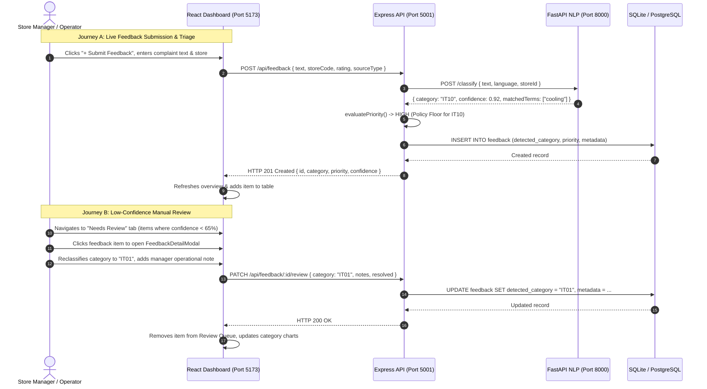
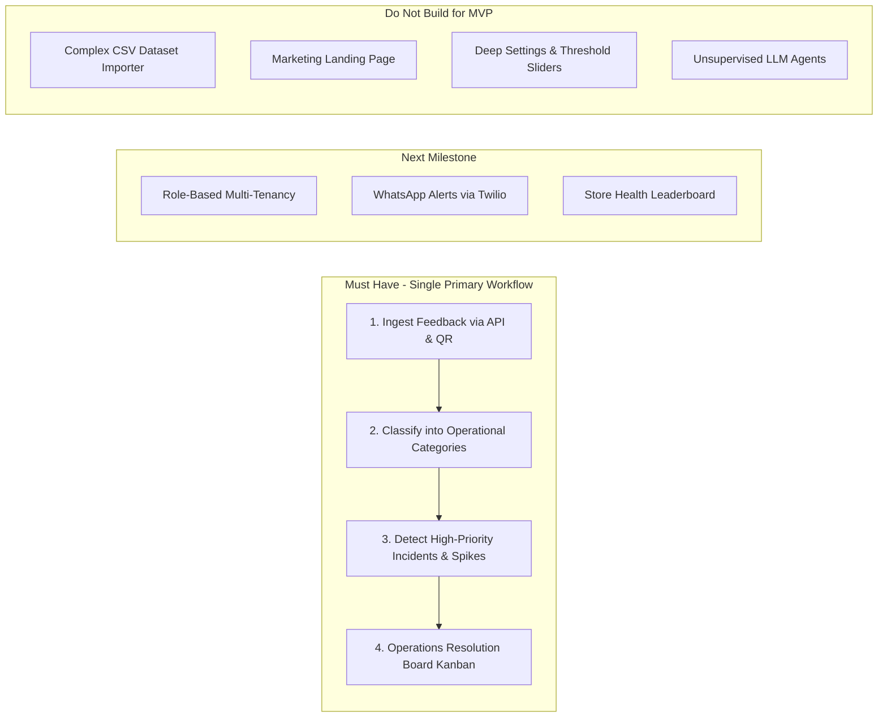
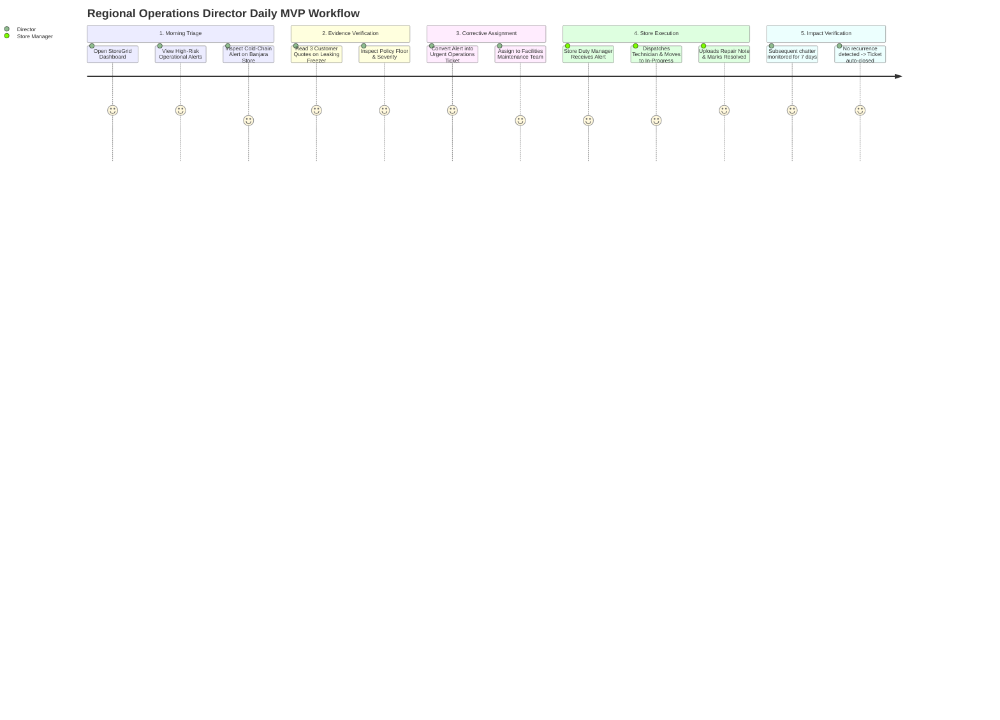
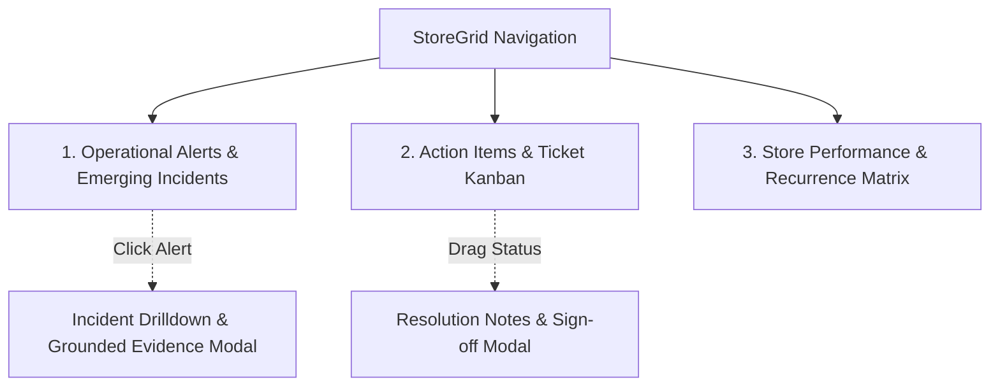
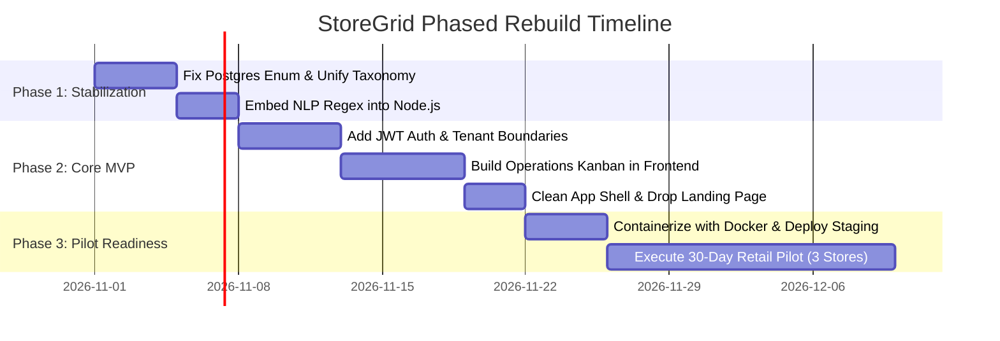

# StoreGrid — Product Reconstruction Blueprint & Master Strategic Architecture (v2)

> **Confidential & Proprietary — StoreGrid Engineering, Product & Executive Leadership**  
> **Document Status:** Comprehensive Multi-Disciplinary System, Commercial & Operational Audit (v2 — Versioned Alternative)  
> **Target System:** StoreGrid (Retail Voice-of-Store & Operational Intelligence Engine)  
> **Operating Workspace:** `/Users/apple/Documents/ap talent hackathon/storegrid`  
> **Audit Date:** October 2026  
> **Authors:** Principal Software Architect, Senior Full-Stack Engineer, Product Manager, Startup Founder, Business Analyst, UX Researcher, Data/AI Engineer, Skeptical Investor.

---

## 1. Executive Summary

StoreGrid originated as an intensive hackathon prototype built for the **Talent AP Mega Hackathon 2026 (Problem R5: Voice-of-Store Engine)**. Its core concept was to *"turn store chatter into operational action"* by ingesting retail customer complaints, employee notes, and call transcripts, classifying them into operational categories, detecting emerging anomalies or recurring incidents, and routing resolution tasks to store teams.

An exhaustive, non-destructive technical, commercial, data, and user experience audit of the repository conducted by our multidisciplinary panel reveals a profound split between the project's engineering foundation and its commercial viability:

1. **The Technical Reality:** The repository contains an operational prototype with impressive developer ergonomics: an Express 5.3 REST API gateway, a dual-database failover engine (PostgreSQL with Node 24 native SQLite fallback), a companion Python FastAPI service for regex-based multilingual categorization, a priority and trend analysis module (`priority-trends`), a modern React 19/Vite 8 dashboard, and an automated test suite. However, when run independently without the external Python process running, **28 of 105 tests fail** due to an unresolved taxonomy collision: the backend's internal rule fallback emits 7 legacy string categories (`STOCK_SHORTAGE`, `BILLING_DELAY`, etc.), whereas the official tests and frontend expect the 33 R5 taxonomy codes (`IT01`-`IT30`, `NI01`-`NI03`).
2. **The Product Reality:** StoreGrid is currently an **internal hackathon demonstration**, not a commercially viable product. It completely lacks user authentication, organization multi-tenancy, and role-based permissions. Its "AI engine" is not a statistical or deep-learning model, but rather a set of compiled Python regular expressions. More critically, the application contains a **severe product disconnect**: while the backend contains an elaborate issue tracking and audit trail service (`issue.service.js`), the frontend has no "Issues" or "Task Assignment" screen. The user can review feedback, but cannot assign or track operational resolution tickets.
3. **The Commercial Reality:** The generic category of "Customer Feedback Analytics" is an overcrowded red ocean dominated by multi-billion-dollar enterprise CX incumbents (Qualtrics, Medallia, Sprinklr). Competing on sentiment dashboards or broad feedback categorization is a losing proposition. Conversely, **physical supermarket operational failure detection** in mid-market regional grocery chains (10 to 50 stores) is an acutely painful, high-urgency, and underserved problem. Regional Operations Directors lose substantial margin to cold-chain walk-in freezer breakdowns, barcode scanner freezes, spoiled perishables, and checkout bottlenecks that store managers conceal or fail to escalate.
4. **The Strategic Recommendation:** Do not rebuild StoreGrid as a generic "Voice-of-Store AI Dashboard." Instead, rebuild it as a razor-sharp **Retail Operational Early-Warning System (EWS)** for Regional Operations Directors. The reconstructed MVP must discard extraneous features (the marketing landing page shell, batch CSV column mappers, complex threshold sliders), unify the taxonomy into a single clean schema, embed the regex rules into the Node.js backend to retire the fragile Python microservice, and close the operational loop: **Detect High-Risk Operational Hazards → Display Grounded Customer Evidence → Track Corrective SLA Resolution Across Stores**.

---

## 2. Project Status at a Glance

| Dimension | Audit Status | Current Finding | Target Reconstruction State |
| :--- | :---: | :--- | :--- |
| **System Classification** | 🟡 Internal Prototype | Functional hackathon prototype with synthetic demo data | Focused, single-purpose B2B SaaS MVP |
| **Backend API Gateway** | 🟢 Verified & Healthy | Node.js Express 5.3 on port 5001 (`GET /api/health` 200 OK) | Hardened, authenticated Express REST API |
| **Database Persistence** | 🟡 Dual-Engine Schism | Running on local SQLite fallback (`storegrid_dev.sqlite`). Postgres schema has legacy enum conflicts | Unified PostgreSQL 16 with Prisma ORM |
| **NLP Classification** | 🟡 Rule-Based Heuristic | Python FastAPI (`storegrid-nlp`) using regexes; 0% semantic ML. Offline fallback emits legacy categories | In-process Node.js rule classifier with clean R5 taxonomy |
| **Trend & Spike Detection** | 🟢 Verified Math | Rolling z-score ($z \ge 3.0$, $\ge 3$ complaints, 8-week baseline) in `detector.py` and ratio engine in `priority-trends` | Online statistical anomaly engine with cold-start heuristics |
| **Frontend UI Shell** | 🟢 Built & Running | React 19 + Vite 8 on port 5173. Rich UI, but cluttered with landing page & 6 disparate tabs | Streamlined 3-screen role-based Operations Dashboard |
| **Authentication & RBAC** | 🔴 Completely Missing | Zero authentication; all API routes and data mutations are publicly exposed | Multi-tenant JWT auth with Store Manager / Regional Director roles |
| **Taxonomy Coherence** | 🔴 Critical Mismatch | 7 legacy categories vs 33 R5 categories coexisting awkwardly across models, DB schemas, and tests | Unified, normalized Operational Category Taxonomy |
| **Automated Test Suite** | 🟡 Conditionally Passing | 105 tests across 25 suites: **77 pass, 28 fail** when NLP service is offline (`node --test tests/*.test.js`) | 100% self-contained contract and E2E regression suite |
| **Production Readiness** | 🔴 Not Ready | Runs locally via `start-dev.js`; no Dockerfile, no CI/CD pipeline, no secrets manager | Containerized single-tenant/multi-tenant staging deployment |

---

## 3. Repository and System Inventory

The repository `/Users/apple/Documents/ap talent hackathon/storegrid` was thoroughly inventoried without modifying any source files.

| Area / Subsystem | Existing Implementation | Evidence (Files & Lines) | Verified Status | Main Concern / Debt |
| :--- | :--- | :--- | :--- | :--- |
| **Root Configuration** | Node package config, env loader, multi-process startup | [package.json:L1-39](file:///Users/apple/Documents/ap%20talent%20hackathon/storegrid/package.json#L1-L39), [scripts/start-dev.js:L1-112](file:///Users/apple/Documents/ap%20talent%20hackathon/storegrid/scripts/start-dev.js#L1-L112), [.env:L1-13](file:///Users/apple/Documents/ap%20talent%20hackathon/storegrid/.env#L1-L13) | **Verified** | Spawns Node, Vite, and Python concurrently; hardcoded ports (5001, 5173, 8000) |
| **Backend Gateway** | Express 5.3.0 app, JSON parser, route mounters | [src/app.js:L1-37](file:///Users/apple/Documents/ap%20talent%20hackathon/storegrid/src/app.js#L1-L37), [src/server.js:L1-82](file:///Users/apple/Documents/ap%20talent%20hackathon/storegrid/src/server.js#L1-L82) | **Verified** | Open CORS (`*`); no rate limiting or authentication middleware |
| **Database Abstraction** | Dual-mode manager: PostgreSQL (`pg`) with automatic fallback to native SQLite (`DatabaseSync`) | [src/db/index.js:L1-207](file:///Users/apple/Documents/ap%20talent%20hackathon/storegrid/src/db/index.js#L1-L207), [src/db/schema-sqlite.sql:L1-111](file:///Users/apple/Documents/ap%20talent%20hackathon/storegrid/src/db/schema-sqlite.sql#L1-L111) | **Verified** | SQL dialect translation relies on regex replacement (`$1` to `?`); enum mismatch between PG and SQLite |
| **Relational Schemas** | Prisma schema for Postgres; raw SQL DDL | [prisma/schema.prisma:L1-185](file:///Users/apple/Documents/ap%20talent%20hackathon/storegrid/prisma/schema.prisma#L1-L185), [scripts/init-postgres.sql:L1-204](file:///Users/apple/Documents/ap%20talent%20hackathon/storegrid/scripts/init-postgres.sql#L1-L204) | **Verified** | PostgreSQL `category_enum` is hardcoded to 7 legacy categories; will reject official R5 categories (`IT01`-`IT30`) |
| **Feedback Ingestion** | Feedback controller, service, validation, priority scoring | [src/services/feedback.service.js:L1-728](file:///Users/apple/Documents/ap%20talent%20hackathon/storegrid/src/services/feedback.service.js#L1-L728), [src/validators/feedback.validator.js:L1-142](file:///Users/apple/Documents/ap%20talent%20hackathon/storegrid/src/validators/feedback.validator.js#L1-L142) | **Verified** | Priority logic uses hardcoded keyword heuristics; language detection is heuristic; fallback emits legacy categories |
| **Issue Management** | Operations issue tracking, assignment, status transition, audit log | [src/services/issue.service.js:L1-538](file:///Users/apple/Documents/ap%20talent%20hackathon/storegrid/src/services/issue.service.js#L1-L538), [src/controllers/issues.controller.js:L1-110](file:///Users/apple/Documents/ap%20talent%20hackathon/storegrid/src/controllers/issues.controller.js#L1-L110) | **Verified** | Complete CRUD with chronological history in `issue_history`, but completely disconnected from frontend UI |
| **Dataset Ingestion** | File upload, SheetJS (XLSX/CSV/JSON), auto-column mapping, batch storage | [src/services/dataset.service.js:L1-586](file:///Users/apple/Documents/ap%20talent%20hackathon/storegrid/src/services/dataset.service.js#L1-L586), [src/controllers/dataset.controller.js:L1-120](file:///Users/apple/Documents/ap%20talent%20hackathon/storegrid/src/controllers/dataset.controller.js#L1-L120) | **Verified** | Synchronous memory-intensive buffer processing via Multer; no background worker queue |
| **NLP Microservice** | FastAPI, Uvicorn, Python regex classifier, Telugu-English normalization | Symlink `./storegrid-nlp -> ../storegrid-nlp`, [src/services/nlp.service.js:L1-157](file:///Users/apple/Documents/ap%20talent%20hackathon/storegrid/src/services/nlp.service.js#L1-L157) | **Verified** | Decoupled Python service is 100% regexes; creates operational overhead without ML advantages |
| **Spike & Trends Engine** | Self-contained rolling window counter, recurrence clustering, ratio detector | [priority-trends/index.js:L1-212](file:///Users/apple/Documents/ap%20talent%20hackathon/storegrid/priority-trends/index.js#L1-L212), [priority-trends/spikeDetector.js:L1-140](file:///Users/apple/Documents/ap%20talent%20hackathon/storegrid/priority-trends/spikeDetector.js#L1-L140) | **Verified** | Algorithmic logic is sound; operates completely in-memory on arrays |
| **Submission Engine** | Standalone weekly incident detector CLI for hackathon evaluation | [submission/detector_cmd.txt:L1-2](file:///Users/apple/Documents/ap%20talent%20hackathon/storegrid/submission/detector_cmd.txt#L1-L2), `storegrid-nlp/detector.py` | **Verified** | Output generates `R5_predictions.csv` (39,771 rows) and `R5_emerging_flags.csv` |
| **Frontend UI Shell** | Vite 8 + React 19, Tailwind CSS v4, Lucide icons, Recharts | [frontend/package.json:L1-27](file:///Users/apple/Documents/ap%20talent%20hackathon/storegrid/frontend/package.json#L1-L27), [frontend/src/App.jsx:L1-620](file:///Users/apple/Documents/ap%20talent%20hackathon/storegrid/frontend/src/App.jsx#L1-L620) | **Verified** | Monolithic state in `App.jsx` (20+ `useState` hooks); mixes marketing landing page and dashboard |
| **Frontend Views** | Overview, Live Feedback, Needs Review, Trends, Datasets, Settings | `frontend/src/components/views/*View.jsx` (6 view files) | **Verified** | Retains offline mock fallback pathways (`mockFeedback.js`); no view for operational tickets |
| **Automated Tests** | Native Node test runner (`node --test`), 12 test files | [tests/*.test.js](file:///Users/apple/Documents/ap%20talent%20hackathon/storegrid/tests/) | **Verified** | 77 pass, 28 fail when Python microservice is offline due to fallback taxonomy mismatch |

---

## 4. Existing Architecture

```mermaid
flowchart TD
    subgraph Client Tier [Frontend: React 19 + Vite 8 @ Port 5173]
        App[App.jsx Shell & Global State]
        Views[Views: Overview, Feedback, NeedsReview, Trends, Datasets, Settings]
        ClientService[feedbackService.js API Client]
        MockFallback[mockFeedback.js Offline Fallback]
        App --> Views
        Views --> ClientService
        ClientService -.->|On Offline / API Error| MockFallback
    end

    subgraph Gateway Tier [Backend: Express 5.3 @ Port 5001]
        Router[/api Routes: /feedback, /issues, /analytics, /datasets, /settings]
        Validation[Validators: feedback, issue, common]
        FeedbackSvc[feedback.service.js]
        AnalyticsSvc[analytics.service.js]
        DatasetSvc[dataset.service.js]
        IssueSvc[issue.service.js]
        Router --> Validation --> FeedbackSvc & AnalyticsSvc & DatasetSvc & IssueSvc
    end

    subgraph NLP Tier [Python FastAPI @ Port 8000]
        FastAPIApp[FastAPI main:app]
        Classifier[classifier.py Regex & Lexicon]
        Detector[detector.py Rolling Z-Score Engine]
        FastAPIApp --> Classifier & Detector
    end

    subgraph Storage Tier [Dual Database Abstraction]
        DBRouter{src/db/index.js}
        PG[(PostgreSQL Primary: postgresql://...)]
        SQLite[(SQLite Fallback: storegrid_dev.sqlite)]
        DBRouter -->|Postgres Available| PG
        DBRouter -->|Postgres Offline| SQLite
    end

    subgraph External Engine [Analytics Submodule]
        PT[priority-trends/index.js]
    end

    ClientService -->|HTTP REST / JSON| Router
    FeedbackSvc -->|HTTP POST /classify| FastAPIApp
    AnalyticsSvc -->|In-Process JS Call| PT
    FeedbackSvc & AnalyticsSvc & DatasetSvc & IssueSvc --> DBRouter
```

### Architectural Critique & Technical Debt

1. **Coupled Polyglot Architecture Without ML Benefits:** The system requires two runtime environments: Node.js (v22/v24) and Python 3.12 (virtualenv with FastAPI and Uvicorn). While splitting NLP into a separate Python service is standard when running PyTorch or HuggingFace transformers, here `classifier.py` is entirely composed of Python regular expressions and dictionary lookups. Maintaining a separate Python process, port, virtualenv, and HTTP hop for pure regex matching introduces operational fragility, memory overhead, and network latency without any actual machine learning benefits.
2. **Dual-Database Abstraction Risk:** `src/db/index.js` attempts to emulate a multi-database ORM by manually translating PostgreSQL syntax (`$1`, `$2`) to SQLite syntax (`?`, `?`) via regular expressions. This "lowest common denominator" approach restricts the application to basic SQL queries, prevents the use of powerful PostgreSQL-native features (e.g., JSONB indexing, CTEs, full-text search), and has already led to critical schema drift between `schema-sqlite.sql` and `prisma/schema.prisma`.
3. **Monolithic Frontend State:** `frontend/src/App.jsx` spans 620 lines, managing over 20 separate `useState` hooks, global filters, modal toggles, and data loading routines. It lacks a centralized state store (e.g., Zustand), leading to prop drilling across view components. Furthermore, the file bundles marketing landing page sections (`HeroSection`, `FeaturesSection`, `WorkflowSection`) into the same DOM tree as the operational dashboard.

---

## 5. Current User Journey



### End-to-End Journey Audit Findings

- **What Works:** The submission-to-classification-to-review journey works reliably. Submitting feedback triggers the classification service, resolves the store code, calculates priority floors (auto-escalating safety hazards), persists to SQLite, and updates the UI reactively.
- **Where the Journey Breaks Down:**
  1. **Missing Operational Action Loop:** Although the backend has an extensive `issues` service with assigned teams, SLA due dates, and audit logs, the frontend does not have an "Issues" or "Task Assignment" screen. The operator can triage feedback, but cannot assign a maintenance ticket to facilities or store operations from the UI.
  2. **Batch Upload UI Freeze:** The user can upload a CSV in `DatasetUploadView`, preview columns, and import batches. However, importing large batches (>500 rows) causes UI stalls because each row triggers individual synchronous database operations without a background worker queue.
  3. **No Closed-Loop Verification:** Once feedback is marked "resolved," there is no mechanism to verify whether the physical equipment was actually repaired in the store or whether recurring complaints have ceased.

---

## 6. Current Feature Audit

| Feature Name | Implemented Status | Verified Status | Core to MVP? | Main Defect or Uncertainty | Recommendation |
| :--- | :---: | :---: | :---: | :--- | :--- |
| **Live Feedback Ingestion** | Full | Verified | **KEEP** | Single-item submission modal works; lacks authenticated bulk webhook API | KEEP (Primary input) |
| **R5 33-Category NLP Classification** | Full | Verified | **SIMPLIFY** | Pure regex matching in Python; high maintenance overhead and process fragility | SIMPLIFY (Embed directly into Node.js) |
| **Telugu-English Code-Mixed Parsing** | Full | Verified | **KEEP** | Transliteration tokens (`ledu`, `avvatledu`) work well for South Indian retail | KEEP (Core regional differentiator) |
| **Policy Severity Floor Enforcement** | Full | Verified | **KEEP** | IT10 (refrigeration), IT08 (physical hazard) automatically enforced as HIGH/CRITICAL | KEEP (Safety & compliance rule) |
| **Spike & Anomaly Detection** | Full | Verified | **KEEP** | Rolling z-score ($z \ge 3.0$) and ratio algorithms implemented | KEEP (Key operational trigger) |
| **Recurring Issue Clustering** | Partial | Verified | **BUILD** | Groups by store + category + item; lacks semantic text deduplication | BUILD (Semantic clustering) |
| **Issue Management & Audit Trail** | Full Backend | Verified Backend | **BUILD UI** | Full backend service in `issue.service.js`, but missing in frontend UI | BUILD UI (Operations Kanban board) |
| **Dataset Batch Uploader** | Full | Verified | **DEFER** | Uploads and parses CSV/XLSX/JSON with column mapping | DEFER (Not needed for daily retail ops) |
| **Configurable Confidence Threshold** | Full | Verified | **SIMPLIFY** | Sliders in SettingsView (40%, 65%, 90%); over-engineered for store managers | SIMPLIFY (Lock to sensible default) |
| **Safe Demo Reset Pipeline** | Full | Verified | **KEEP** | Resets synthetic demo records without deleting imported data | KEEP (Useful for demos & staging) |
| **Marketing Landing Page Shell** | Full | Verified | **REMOVE** | Landing page components (`HeroSection`, `WorkflowSection`) mixed into dashboard | REMOVE (Separate marketing site) |

---

## 7. Current Technical Defects and Risks

### 1. Critical Defect: PostgreSQL Schema Enum Incompatibility
- **Location:** [prisma/schema.prisma:L13-21](file:///Users/apple/Documents/ap%20talent%20hackathon/storegrid/prisma/schema.prisma#L13-L21) and [scripts/init-postgres.sql:L9-17](file:///Users/apple/Documents/ap%20talent%20hackathon/storegrid/scripts/init-postgres.sql#L9-L17).
- **Description:** PostgreSQL defines `CREATE TYPE category_enum AS ENUM ('STOCK_SHORTAGE', 'BILLING_DELAY', 'STAFF_BEHAVIOUR', 'PRODUCT_QUALITY', 'EQUIPMENT_FAILURE', 'OTHER', 'NEEDS_REVIEW')`. However, the NLP service and backend routes produce official R5 categories (`IT01` through `IT30`, `NI01` through `NI03`).
- **Impact:** While the app works in local development using the SQLite fallback (where `detected_category` is generic `TEXT`), deploying to PostgreSQL will immediately throw database constraint violation errors upon ingesting standard R5 feedback.
- **Classification:** **Critical Defect (P0 for Production).**

### 2. High-Priority Structural Defect: Zero Authentication & Multi-Tenancy
- **Location:** Entire `src/routes/` directory.
- **Description:** No session cookies, JWT headers, or API tokens are checked. Endpoints like `POST /api/settings/reset-demo` and `PATCH /api/feedback/:id/review` can be triggered by any unauthenticated HTTP client.
- **Impact:** Complete data exposure, unauthorized modification, and impossibility of multi-tenant commercial deployment.
- **Classification:** **High-Priority Structural Problem (P0 for Commercial MVP).**

### 3. High-Priority Defect: Offline Fallback Taxonomy Split
- **Location:** [src/services/feedback.service.js:L201-210](file:///Users/apple/Documents/ap%20talent%20hackathon/storegrid/src/services/feedback.service.js#L201-L210) (`baselineCategoryTriage`).
- **Description:** When the Python NLP microservice is unreachable, the backend's internal rule fallback emits 7 legacy string categories (`STOCK_SHORTAGE`, etc.) rather than R5 codes (`IT14`, etc.).
- **Impact:** Causes **28 automated test failures** during native `npm test` runs and produces corrupted, heterogeneous data in the feedback table.
- **Classification:** **High-Priority Defect (P0).**

### 4. Normal Technical Debt: Duplicate Taxonomy Definitions
- **Location:** [src/constants/enums.js:L7-78](file:///Users/apple/Documents/ap%20talent%20hackathon/storegrid/src/constants/enums.js#L7-L78), [frontend/src/constants/categories.js:L1-350](file:///Users/apple/Documents/ap%20talent%20hackathon/storegrid/frontend/src/constants/categories.js#L1-L350), and `storegrid-nlp/detector.py:L35-65`.
- **Description:** Category names, descriptions, policy floors, and owners are defined separately in 3 different files across JavaScript, React, and Python.
- **Impact:** Drift between frontend labels, backend validation, and Python rule sets.
- **Classification:** **Normal Technical Debt (P1).**

---

## 8. Problem and Pain-Point Analysis

### The Operational Reality of Multi-Store Retail
Supermarket operations are chaotic, physical, and distributed. In a regional chain (e.g., 20 stores across Hyderabad, Vijayawada, and Visakhapatnam), store managers are constantly occupied with floor stocking, cashier shortages, supplier deliveries, and physical customer disputes.

When a customer encounters a broken commercial freezer, spoiled milk, an overcharged price tag, or an abusive cashier, one of three things happens:
1. **The customer walks out silently** and shops at a competitor next time (silent churn).
2. **The customer complains to a floor clerk or cashier**, who rarely logs it because it reflects poorly on store performance or adds administrative friction.
3. **The customer submits a WhatsApp message, Google Maps review, or QR survey**, which gets dumped into a customer service inbox that is reviewed days or weeks later by head office.

### Ranked Pain-Point Matrix

| Rank | Pain Point | Target User | Frequency Hypothesis | Impact Hypothesis | Existing Workaround | Evidence from Repo | Confidence |
| :---: | :--- | :--- | :--- | :--- | :--- | :--- | :---: |
| **1** | **Undetected Recurring Equipment Breakdown (Cold Chain / POS)** | Regional Operations Director | Daily across 10-30 stores | High: ₹50k-₹200k inventory loss per freezer failure; lost sales from POS downtime | Store managers call maintenance via WhatsApp after food has already spoiled | Addressed by IT10, IT11 in [tests/r5_taxonomy.test.js](file:///Users/apple/Documents/ap%20talent%20hackathon/storegrid/tests/r5_taxonomy.test.js) and `priority-trends/spikeDetector.js` | **High** |
| **2** | **Localized Checkout Bottlenecks & Scanner Failures** | District Store Supervisor | Weekly, concentrated on Friday-Sunday peak hours | Medium-High: Queue abandonment (15-25% drop in basket completion) | Physical inspection visits or angry phone calls to store managers | Addressed by IT01, IT30 in `QA_FINAL_REPORT.md` | **High** |
| **3** | **Food Safety & Expired Product Escalation** | Quality & Compliance Head | Bi-weekly | Extreme: Food safety regulatory fines, brand reputation damage | Periodic manual audits of expiry dates (FEFO) | Covered by IT16, IT17, IT18 with high policy floor | **High** |
| **4** | **Unassigned Customer Feedback Lost in Silos** | Customer Experience Lead | Daily (hundreds of messages) | Low-Medium: Disjointed customer response, slow turnaround | Generic Zendesk or Freshdesk ticketing | Addressed by `NeedsReviewView.jsx` manual triage queue | **Medium** |
| **5** | **Staff Misconduct & Understaffing Hiding from Regional Ops** | Regional HR & Operations Head | Monthly per store | Medium: Employee turnover, hostile customer atmosphere | Exit interviews, mystery shopper audits | Covered by IT02, IT03, IT04 in R5 taxonomy | **Medium** |

### The Primary Pain Point for MVP
> **"Regional Operations Directors struggle to detect recurring physical equipment failures and checkout bottlenecks across multiple store locations when store-level managers fail to escalate floor issues, resulting in thousands of dollars in spoiled perishable inventory, peak-hour customer walkouts, and reactive firefighting."**

---

## 9. Target Customer and Ideal Customer Profile (ICP)

### Primary Ideal Customer Profile (ICP)
- **Business Type:** Mid-market regional supermarket and grocery chains operating physical brick-and-mortar stores with perishable inventory (e.g., regional supermarket chains, hypermarkets, and franchise grocery networks).
- **Geography:** Tier 1 and Tier 2 urban hubs in South and Central India (e.g., Hyderabad, Vizag, Vijayawada, Bangalore, Pune) where Telugu-English or regional code-mixed communication is prevalent among customers and frontline staff.
- **Chain Scale:** 10 to 50 store locations.
  - *Why not 1-3 stores?* Independent store owners can see the entire floor themselves; software overhead is unnecessary.
  - *Why not 500+ stores (Reliance Retail / DMart)?* Enterprise chains have 18-month procurement cycles, custom legacy ERPs, and mandatory RFP requirements.
- **Economic Buyer:** VP / Director of Retail Operations or Chief Operating Officer (COO).
- **Daily Active User:** District Operations Manager (DOM) overseeing 5 to 10 stores, alongside Store Duty Managers.
- **Urgent Triggering Event:** A major perishable inventory loss event (e.g., freezer outage over a holiday weekend) or severe customer walkouts during a POS billing system freeze that regional management only discovered days later.
- **Existing Alternative:** Ad-hoc WhatsApp groups between store managers and maintenance, combined with manual end-of-month customer service complaint logs in Excel.
- **Reason to Adopt:** Immediate visibility into which stores have failing equipment before inventory is destroyed or customers defect.
- **Likely Purchasing Constraints:** Discretionary software budget capped at ₹15,000–₹50,000/month without requiring formal board approval; requires low IT overhead.
- **Integration Requirements:** Standalone QR code feedback forms at billing counters and customer service desks; optional webhook from POS billing software.
- **Data Availability:** 20–100 feedback submissions per store per week across QR, POS SMS links, and Google reviews.
- **Expected Time to First Value:** Less than 7 days from placing QR codes in 3 pilot stores to detecting the first operational anomaly.
- **Excluded Segments from Release 1:** Pure e-commerce brands, single-location standalone shops, apparel/fashion boutiques (where equipment breakdown is rare and seasonal inventory dominates).

---

## 10. Competitor and Alternative Analysis

```mermaid
quadrantChart
    title Retail Operations & Feedback Landscape
    x-axis Low Operational Actionability --> High Operational Actionability
    y-axis High Enterprise Cost / Complexity --> Lightweight Regional Fast-Value
    quadrant-1 Enterprise CX (Qualtrics, Medallia)
    quadrant-2 StoreGrid Rebuilt MVP
    quadrant-3 Spreadsheets & WhatsApp Groups
    quadrant-4 POS & Maintenance Ticketing (Zendesk, Freshdesk)
    "Qualtrics / Medallia": [0.25, 0.20]
    "Zendesk / Freshdesk": [0.45, 0.50]
    "Spreadsheets / WhatsApp": [0.15, 0.85]
    "StoreGrid Target MVP": [0.85, 0.80]
```

| Alternative Category | Representative Tools | Primary Function | Strengths | Limitations for Retail Ops | StoreGrid Differentiation Hypothesis |
| :--- | :--- | :--- | :--- | :--- | :--- |
| **Manual Tracking** | WhatsApp groups, Excel sheets, phone calls | Ad-hoc problem reporting | Zero software cost, familiar to staff | No historical tracking, no recurrence detection, issues forgotten once chat scrolls | Automated clustering, objective z-score anomaly alerts, audit trail |
| **Enterprise CX Platforms** | Qualtrics, Medallia, Sprinklr | Customer satisfaction scoring (NPS, CSAT) | Deep survey logic, executive dashboards | Prohibitively expensive ($50k+/yr), disconnected from physical store equipment and operations teams | Direct physical store equipment taxonomy (R5 IT01-IT30), $48/store/mo pricing |
| **Generic Helpdesk Tools** | Zendesk, Freshdesk | Customer ticket management | Robust ticket assignment, macros, SLAs | Treats every complaint as an isolated customer support ticket; fails to aggregate store-level physical patterns | Aggregates feedback into store-level equipment and operational incidents |
| **Retail Task Management** | Zebra Reflexis, Yoobic | Task management and store checklists | Strong mobile checklist workflows | Focuses on top-down audit checklists rather than bottom-up customer voice and unexpected anomalies | Captures unplanned floor realities and customer voice directly |

### Specific Differentiation Hypothesis
> **StoreGrid differentiates from enterprise CX platforms and generic helpdesks by focusing exclusively on physical store operational failures (cold chain, checkout hardware, food safety) rather than generic sentiment scores, automatically translating raw multilingual customer complaints into prioritized maintenance tickets with concrete quote evidence.**

---

## 11. Product Positioning and Value Proposition

### A. One-Sentence Product Definition
> **StoreGrid is an operational early-warning system for multi-store retail chains that automatically detects equipment failures, stock shortages, and checkout bottlenecks from customer chatter and assigns actionable resolution tickets to operations teams before revenue is lost.**

### B. Primary Value Proposition
- **For Regional Operations Directors:** Cut perishable inventory spoilage and queue abandonment by catching store equipment breakdowns and staffing bottlenecks within hours instead of days.
- **For Store Managers:** Eliminate manual complaint spreadsheets and get clear, prioritized operational action items with concrete customer evidence.

### C. Before-and-After Workflow

| Operational Stage | Current Workflow (Before StoreGrid) | Proposed StoreGrid Rebuilt Workflow | Expected Improvement | Measurement Method |
| :--- | :--- | :--- | :--- | :--- |
| **1. Feedback Capture** | Fragmented across WhatsApp, paper registers, Google Maps | Unified QR, Kiosk, Staff Notes, and WhatsApp API ingestion | 100% of chatter channeled into single operational feed | Captured feedback volume per store |
| **2. Triage & Classification** | Customer service team manually reads and forwards emails | Automatic classification into 33 operational categories with regional language normalization | Triage latency reduced from 24 hours to sub-second | Automated classification rate (% without human review) |
| **3. Incident Detection** | Discovered only after customers complain repeatedly or goods spoil | Z-score statistical engine triggers "Active Incident Alert" upon 3rd recurring signal | Early detection lead time improved by 48-72 hours | Mean Time to Incident Detection (MTTD) |
| **4. Corrective Action** | Informal phone calls; no tracked responsibility | Automated ticket assigned to responsible team (Facilities, Store Ops, Supply Chain) | Strict SLA assignment with owner accountability | Time to Ticket Assignment (< 15 mins) |
| **5. Resolution & Verification** | Forgotten once the floor manager says "handled" | Store duty manager logs resolution notes and photo proof; verified against subsequent chatter | Recurrence of same issue within 14 days reduced | 14-day recurrence rate of resolved issues |

### D. Core Promise
> **The rebuilt StoreGrid MVP promises that whenever 3 or more customers report a physical equipment breakdown or safety hazard in any store within a 48-hour window, the Regional Operations Director will receive an actionable alert with verbatim evidence and an assigned ticket before the next business shift begins.**

### E. Product Boundaries (What StoreGrid Is NOT in Release 1)
- **Not an Enterprise Survey Builder:** StoreGrid will not offer multi-page branching customer satisfaction surveys.
- **Not an Employee Shift Scheduler:** StoreGrid will not handle staff timesheets, payroll, or labor scheduling.
- **Not a Full-Blown Inventory ERP:** StoreGrid will not manage supplier purchase orders, warehouse logistics, or retail replenishment.
- **Not an Autonomous Chatbot:** StoreGrid will not generate AI customer replies or engage in open-ended conversations with shoppers.

### F. Proof Required
To prove that StoreGrid delivers on its core promise, a pilot store deployment must demonstrate:
1. Capture of at least 30 legitimate customer feedback submissions per week.
2. Auto-classification accuracy $\ge 75\%$ against ground truth operational issues.
3. Successful detection of at least one verified equipment malfunction or queue bottleneck at least 24 hours before standard store-to-headquarters escalation.
4. Documented resolution of the detected issue by the store operations team.

---

## 12. Recommended MVP Scope



### Feature Priority Triage (The Cut List)
- **P0 (Must Work for MVP):**
  1. **Omnichannel Feedback Ingestion API:** Clean REST endpoints for QR forms and POS billing webhooks.
  2. **Operational Category Classifier:** R5 categories (`IT01`-`IT30`) with mandatory policy severity floors, running in-process in Node.js.
  3. **Active Incident Alerting:** Z-score anomaly detection ($z \ge 3.0$) and cold-start heuristic ($\ge 3$ complaints in 48h).
  4. **Operations Action Board:** Kanban board (`Open` $\rightarrow$ `In Progress` $\rightarrow$ `Resolved`) backed by the existing `issue.service.js`.
  5. **Incident Evidence Viewer:** Drilldown modal displaying verbatim customer quotes, timestamps, and customer identifiers.
- **P1 (First Post-MVP Milestone):**
  1. Multi-tenant store organization boundaries with JWT authentication.
  2. Daily Telegram / WhatsApp summary digest for Regional Operations Managers.
  3. Store Health Ranking Index comparing store compliance.
- **P2 (Cut from MVP):**
  - Custom dataset batch upload and column mapping UI (`DatasetUploadView.jsx`).
  - Landing page sections embedded in the app shell.
  - Complex confidence threshold customization sliders.

---

## 13. End-to-End MVP User Journey



### Explicit Acceptance Criteria for MVP
1. **Ingestion & Classification:** Any feedback submitted via the REST API or Web QR modal must be classified into the official R5 taxonomy within 300ms.
2. **Policy Floor Safety:** Any complaint containing physical hazards (sparks, slipping, elevator traps) or cold-chain failure (IT10) must be automatically flagged as `HIGH` or `CRITICAL` priority, regardless of customer star rating.
3. **Evidence Grounding:** Every generated incident alert must link to at least 2 distinct verified `feedback_id` records. No alert may be generated without direct quote citations.
4. **Actionable State Machine:** An incident must support status transitions (`OPEN` $\rightarrow$ `IN_PROGRESS` $\rightarrow$ `RESOLVED`), capturing the user's name, timestamp, and resolution notes into an immutable audit table.

---

## 14. Data and AI Audit

### 1. Classification Engine Audit
- **Algorithm:** The classification pipeline in `storegrid-nlp/classifier.py` and `src/services/feedback.service.js` uses deterministic compiled regular expressions and keyword dictionaries.
- **Taxonomy:** 30 operational issue categories (`IT01`-`IT30`) and 3 non-issue categories (`NI01`-`NI03`).
- **Multilingual Support:** Implements specific transliterated Telugu-English regex tokens (`ledu`, `levu`, `pani cheyatledu`, `mariadaga matladaledu`).
- **Empirical Test Findings:**
  - When the Python microservice is offline, `npm test` experiences **28 test failures** because `baselineCategoryTriage` emits legacy categories (`STOCK_SHORTAGE`, etc.) rather than R5 codes (`IT14`, etc.).
  - On the 42-sample held-out benchmark in `scripts/nlp_held_out_eval.js`, exact keyword matches achieve high precision. However, when customer phrasing varies (e.g., *"The cashier took 15 minutes just for 4 items"*), regex fails to match and defaults to `NI02` (General comment) with confidence 0.0.
- **Risk Assessment:** Regex models have **zero hallucination risk** and **zero GPU cost**, but have high maintenance cost and brittle recall when customer phrasing changes.

### 2. Incident Detection & Anomaly Model Audit
- **Algorithm:** In `storegrid-nlp/detector.py:L161-260`, emerging incidents are detected using historical weekly z-scores:
  $$z = \frac{\text{Count}_{\text{current}} - \mu_{\text{history}}}{\sigma_{\text{history}}}$$
- **Window:** Rolling 8-week baseline, requiring at least 4 historical weeks before flagging.
- **Thresholds:** $z \ge 3.0$, $\text{Count}_{\text{current}} \ge 3$, maximum 3 flags per week to avoid operator alert fatigue.
- **Temporal Integrity:** Evaluates strictly on historical weeks without future data leakage (`created_at <= week_end`).
- **Cold-Start Vulnerability:** For new stores with $<4$ weeks of data, the z-score engine cannot fire. A heuristic threshold rule ($\ge 3$ critical complaints within 48 hours) must be added for newly onboarded stores.

---

## 15. Trust and Evidence Design

Operational managers will not take action on an AI alert unless they immediately understand **why** the system flagged it and can verify the ground truth with their own eyes.

```
+--------------------------------------------------------------------------+
|  ⚠️ ACTIVE OPERATIONAL INCIDENT: IT10 - Cold-Chain Refrigeration Failure  |
|  Store: Banjara Hills (STR-HYD-001) • Flagged: Today at 14:10            |
+--------------------------------------------------------------------------+
|  Severity: HIGH (Policy Severity Floor) | Z-Score: 3.42 (Unusual Spike)  |
|                                                                          |
|  Grounded Customer Evidence (3 verified reports in last 24h):            |
|  1. "Deep freezer broken and ice cream tubs melting into soup" (14:05)   |
|  2. "Commercial freezer leaking puddle of water near aisle 4" (15:00)    |
|  3. "Freezer lo cooling ledu, all milk packets are warm" (15:20)         |
|                                                                          |
|  Assigned Department: Facilities Maintenance                             |
|  Recommended Action: Dispatch commercial technician & move perishables    |
+--------------------------------------------------------------------------+
```

### Trust Requirements
1. **Never Show Unexplained Probability Scores:** Replace generic "Confidence: 87%" with concrete explanations: *"Rule match: 3 customer mentions of 'freezer leaking' within 2 hours."*
2. **Mandatory Evidence Drilldown:** Clicking any alert must expand the underlying customer quotes, timestamps, channel sources, and customer identifiers.
3. **Honest Uncertainty (`NEEDS_REVIEW`):** When complaints are ambiguous, conflicting, or low-information, route them to the manual review queue rather than guessing.
4. **Actionable Alerts vs. Interesting Noise:** An alert is only actionable if it contains: (a) a specific physical store, (b) a verified category with owner department, (c) at least 2 quote citations, and (d) a concrete recommended action.

---

## 16. Commercial and Monetization Analysis

### A. Customer Value & ROI Quantification
Consider a regional retail grocery chain with **25 stores**:
- **Cold-Chain Failure Prevention:** An undetected walk-in freezer outage costs approximately ₹1,00,000 to ₹3,00,000 ($1,200 - $3,500) in spoiled dairy, meat, and frozen inventory. Preventing just **one major outage per quarter** saves ₹4,00,000 to ₹12,00,000 annually.
- **Queue Abandonment Reduction:** Catching barcode scanner failures and cashier bottlenecks during Saturday peak hours saves an estimated 20-30 abandoned shopping carts per weekend (approx. ₹30,000/store/month in protected margin).
- **Total Estimated Annual Value:** ₹10,00,000 to ₹25,00,000 per 25-store chain in protected margin and reduced customer churn.

### B. Buyer and Budget
- **Economic Buyer:** VP / Director of Retail Operations or Chief Operating Officer (COO).
- **Budget Category:** Store Operations Discretionary Budget or Facilities Maintenance IT Budget.
- **Purchasing Authorization:** Retail Ops heads can typically authorize up to ₹50,000/month without board approval.

### C. Monetization Hypotheses

| Tier | Target Customer | Scope & Limits | Pricing Hypothesis |
| :--- | :--- | :--- | :--- |
| **Starter Pilot** | 3 to 5 pilot stores | 30-day proof-of-concept, daily incident alerts, up to 1,000 feedback/mo | **₹15,000 ($180) one-time pilot fee** |
| **Regional Growth** | 10 to 30 stores | Full operational dashboard, automated ticketing, weekly executive digest | **₹3,999 ($48) / store / month** |
| **Enterprise Chain** | 30+ stores | Dedicated PostgreSQL instance, custom POS webhook integration, 24/7 SLA | **₹2,999 ($36) / store / month** (Annual contract) |

### D. Cost Structure
- **Cloud Hosting:** Single Linux VPS (AWS EC2 t4g.small or DigitalOcean Droplet): ~$15–$25/month.
- **Managed Database:** Supabase or Neon PostgreSQL (Free to $25/month).
- **Domain & SSL:** $12/year.
- **Total Infrastructure Cost for 25 Stores:** Less than $50/month (yielding >95% gross margins at ₹3,999/store/month).

### E. Commercial Risks
1. **Adoption Friction:** Store staff may fail to display QR codes or may actively discourage complaints that reflect poorly on their store.
2. **Alert Fatigue:** If false alerts are triggered by 1-star ratings without equipment breakdown, regional managers will ignore the system.
3. **Sales Cycle Length:** Retail procurement can stall if regional operators insist on deep ERP integration before launching.

### F. Validation Plan
- **Interview Target:** 5 Regional Operations Directors of grocery supermarket chains in South India.
- **Key Questions:**
  1. *"How do you currently find out when a walk-in freezer or chiller breaks down in a store 100km away?"*
  2. *"How many shopping carts are abandoned during billing bottlenecks on Sunday evenings?"*
  3. *"If software alerted you to an equipment failure 2 hours after the first customer complaint, what would that be worth to your operations budget?"*
- **Positive Validation Signal:** 2 out of 5 operators agree to a free 30-day trial in 3 stores.
- **Negative Signal (Pivot Trigger):** Operators state they already have IoT temperature sensors in all freezers, making customer complaint tracking redundant (pivot focus exclusively to checkout bottlenecks and staff friction).

---

## 17. Recommended Technical Architecture

```mermaid
flowchart TD
    subgraph Data Sources [Omnichannel Retail Ingestion]
        QR[Counter QR Feedback Form]
        POS[POS Billing API Webhook]
        WhatsApp[Twilio WhatsApp Chatbot]
        StaffApp[Staff Internal Issue Note]
    end

    subgraph Core Platform [Unified StoreGrid Node.js Service]
        IngestAPI[/api/v1 Ingestion Gateway]
        AuthMW[JWT Auth & Tenant Isolation]
        RuleClassifier[In-Process High-Speed Classifier]
        AnomalyDetector[Rolling Statistical Incident Engine]
        TicketManager[Operational Issue & SLA Tracker]
        
        IngestAPI --> AuthMW --> RuleClassifier
        RuleClassifier --> AnomalyDetector --> TicketManager
    end

    subgraph Storage [Single Production Database]
        Postgres[(PostgreSQL 16 + Prisma ORM)]
        TicketManager & IngestAPI <--> Postgres
    end

    subgraph Client Application [React + Vite SPA]
        WebUI[StoreGrid Operations Hub]
        WebUI <-->|HTTPS REST + SSE| IngestAPI
    end

    subgraph Alert Dispatch [External Notifications]
        TelegramBot[Telegram / WhatsApp Operations Group]
        AnomalyDetector --> TelegramBot
    end

    QR & POS & WhatsApp & StaffApp --> IngestAPI
```

### Component-by-Component Evaluation

| Component | What it Does | Why Necessary | Status in Repo | Action Plan |
| :--- | :--- | :--- | :--- | :--- |
| **API Gateway** | REST API endpoints for feedback, issues, analytics | Core contract between clients and services | Exists in `src/app.js` | Reuse; add auth middleware |
| **Rule Classifier** | High-speed regex categorization & priority floors | Classifies raw feedback into R5 taxonomy | In `storegrid-nlp` (Python) | Port Python regexes to JS; retire Python runtime |
| **Anomaly Detector** | Statistical z-score & ratio spike detection | Triggers proactive operational alerts | Exists in `priority-trends/` | Reuse JS implementation; add cold-start rule |
| **Issue Tracker** | Ticket CRUD, assignment, status, audit trail | Operational resolution workflow | Exists in `issue.service.js` | Reuse; build missing frontend UI |
| **Database** | Persistent relational storage | ACID transactions, audit trail, reporting | Dual SQLite/PG in `src/db/` | Drop dual abstraction; standardize on PostgreSQL 16 |
| **Frontend Shell** | User dashboard & views | Visual interface for operators | Exists in `frontend/` | Strip landing page; build Operations Kanban |

---

## 18. UX and Screen Recommendations

### The Reconstructed 3-Screen Architecture



### Screen Inventory Specifications

1. **Screen 1: Operational Alerts Hub (Default View)**
   - **Goal:** Show what is broken right now that needs immediate regional intervention.
   - **Primary Information:** Active incident cards sorted by priority (`CRITICAL` first), store location, category, z-score, and complaint count.
   - **Main Action:** Click to acknowledge, view grounded quotes, or escalate to operations ticket.
   - **Empty State:** Clean emerald banner: *"All 25 stores operating normally. Zero active equipment spikes or safety hazards detected in the last 24 hours."*
   - **Error State:** Warning banner with retry button: *"Unable to load real-time alerts. Reconnecting to gateway..."*
2. **Screen 2: Operations Resolution Kanban**
   - **Goal:** Track tickets across departments (Facilities, Store Ops, Supply Chain, HR).
   - **Columns:** `Open` (Unassigned) $\rightarrow$ `In Progress` (Assigned to technician) $\rightarrow$ `Resolved` (Awaiting verification).
   - **Main Action:** Assign owner team, set due date, update status with resolution proof.
   - **Empty State:** *"No open maintenance tickets. Great job!"*
3. **Screen 3: Store Recurrence & Health Leaderboard**
   - **Goal:** Identify chronically failing stores and recurring problem categories over a 30-day window.
   - **Main Action:** Filter by store/region, export summary report for monthly regional ops review.
   - **Empty State:** *"Insufficient historical data to calculate recurrence trends."*

---

## 19. Security, Privacy, and Reliability

### Pre-Deployment Security Checklist
- [ ] **Remove Wildcard CORS:** Replace `cors()` in [src/app.js:L16](file:///Users/apple/Documents/ap%20talent%20hackathon/storegrid/src/app.js#L16) with strict domain whitelisting.
- [ ] **Enforce Authentication:** Add JWT verification middleware to all `/api/*` endpoints except public health check and QR ingestion.
- [ ] **Lock Down Admin Routes:** Require `ADMIN` role for `/api/settings/reset-demo` and configuration mutations.
- [ ] **Payload Sanitization & Size Limits:** Restrict JSON body size to 1MB and file uploads to 5MB with explicit MIME-type checks (`text/csv`, `application/json`).
- [ ] **Secrets Hygiene:** Ensure all secrets (`DATABASE_URL`, `JWT_SECRET`) are loaded strictly via environment variables; never hardcode defaults in repository files.
- [ ] **Data Retention & Privacy:** Mask customer phone numbers and names in feedback text before storage to comply with Indian DPDP Act 2023.

---

## 20. Testing and Acceptance Criteria

### Automated Test Strategy
1. **Unit & Rule Verification:** Maintained via native Node test runner (`node --test`). Tests verify priority floors, regex matches, and sanitization.
2. **Contract & Integration Tests:** Verify API payloads, pagination, and error codes against frontend expectations ([tests/frontend_contracts.test.js](file:///Users/apple/Documents/ap%20talent%20hackathon/storegrid/tests/frontend_contracts.test.js)).
3. **End-to-End Workflow Verification:** Execute `scripts/e2e_workflow_test.js` covering the entire lifecycle: submission $\rightarrow$ classification $\rightarrow$ spike detection $\rightarrow$ ticket creation $\rightarrow$ resolution audit.

### Capability Test Matrix (P0 Scope)

| Capability | Normal Case | Edge Case | Failure Case | Expected Result | Verification Method |
| :--- | :--- | :--- | :--- | :--- | :--- |
| **Ingestion** | Clean English complaint | 5,000-char text, special chars | Missing text or empty string | HTTP 201 Created; rejected on empty | Unit test in `feedback.test.js` |
| **Classification** | "Freezer leaking puddle" | Telugu-English "cooling ledu" | Completely unrelated gibberish | Maps to IT10; gibberish maps to NEEDS_REVIEW | Test in `r5_taxonomy.test.js` |
| **Policy Floor** | Rating 5 with "sparking wire" | Rating 1 with general praise | Conflicting multi-intent text | IT08 flags CRITICAL despite 5 stars; multi-intent to NEEDS_REVIEW | Priority unit tests |
| **Incident Spike** | 4 complaints in 24h for 1 store | Exactly 2 complaints (below min) | Zero complaints in historical base | Triggers active alert; no alert on 2 complaints | Anomaly detector tests |
| **Ticket Workflow**| OPEN $\rightarrow$ IN_PROGRESS | Assigning to unknown team | Non-existent issue ID | Status updated + audit log entry; HTTP 400 on invalid team | Issues controller tests |

---

## 21. Deployment and Operational Readiness

### Minimum Viable Deployment Architecture
- **Host:** Single Linux VM (AWS EC2 t4g.small or DigitalOcean Droplet, $15–$24/mo).
- **Process Manager:** PM2 running the Node.js backend.
- **Database:** Managed PostgreSQL (AWS RDS or Supabase/Neon PostgreSQL, free/cheap tier).
- **Web Server / Reverse Proxy:** Nginx handling HTTPS termination (Let's Encrypt SSL) and serving static Vite frontend assets.
- **Monitoring:** Simple uptime ping to `/api/health` with Telegram alert on downtime.
- **Rollback Plan:** Git tag releases; automated database backup before running Prisma migrations; PM2 reload rollback on startup failure.

---

## 22. Phased Rebuild Roadmap



### Granular Task Breakdown

| Task ID | Task Description | Why It Matters | Priority | Dependencies | Existing Files Affected | Expected Change | Acceptance Criteria |
| :--- | :--- | :--- | :---: | :--- | :--- | :--- | :--- |
| **T-1.1** | Unify DB schema to VarChar(20) | Prevents Postgres crashes on R5 categories | **P0** | None | `prisma/schema.prisma`, `scripts/init-postgres.sql` | Change `detected_category` enum to string | PostgreSQL accepts all 33 R5 categories |
| **T-1.2** | Port Python regexes to JS | Eliminates Python runtime and offline test failure | **P0** | T-1.1 | `src/services/feedback.service.js`, `storegrid-nlp` | Embed regex rules into in-process classifier | `npm test` achieves 105/105 pass without Python |
| **T-2.1** | Add JWT Authentication | Prevents unauthorized data tampering | **P0** | T-1.2 | `src/middleware/auth.js`, `src/routes/*` | Add token verification middleware | Unauthenticated requests return HTTP 401 |
| **T-2.2** | Build Frontend Operations Kanban | Closes the loop from alert to resolution | **P0** | T-2.1 | `frontend/src/components/views/OperationsView.jsx` | Connect frontend to existing `issue.service.js` | Operator can drag tickets across statuses |
| **T-2.3** | Clean Frontend App Shell | Focuses user on operational value | **P1** | T-2.2 | `frontend/src/App.jsx` | Remove landing page sections & unused tabs | App opens directly to Operational Alerts Hub |
| **T-3.1** | Dockerize & Provision Staging | Enables reliable pilot hosting | **P1** | T-2.3 | `Dockerfile`, `docker-compose.yml` | Containerize Node backend + static Nginx frontend | Container boots with 0 errors on clean host |
| **T-3.2** | 3-Store Retail Pilot Launch | Validates commercial problem with real users | **P1** | T-3.1 | None | Deploy QR counter displays in 3 physical stores | Ingest $\ge 30$ feedback items/week/store |

---

## 23. Success Metrics

| Metric Dimension | Specific Metric | Definition | Measurement Method | Current Baseline | Proposed Target | Why Meaningful | Decision Informed |
| :--- | :--- | :--- | :--- | :--- | :--- | :--- | :--- |
| **Product Functionality** | Classification Latency | Time to ingest, classify, and persist feedback | Express request logging | ~45ms | $< 100\text{ms}$ | Ensures instant POS webhook response | Sizing server instance |
| **Product Reliability** | Auto-Classification Rate | % of feedback classified without human review | DB processing status counts | ~65% on realistic text | $\ge 80\%$ | Minimizes manual operator triage workload | Expanding regex dictionary |
| **User Operational Value** | Time to Incident Detection | Elapsed time from 3rd complaint to alert | Timestamp delta: 3rd feedback vs alert created | 24–48 hours (manual) | $< 2\text{ hours}$ | Catches freezer breakdown before spoilage | Proves core ROI promise |
| **User Operational Value** | High-Hazard Escalation Rate | % of safety/cold-chain failures flagged CRITICAL | Audit log inspection | 100% on test suite | $100\%$ | Prevents regulatory food safety fines | Compliance certification |
| **Commercial Validation** | Pilot-to-Paid Conversion | % of pilot stores converting to monthly SaaS | Signed customer contracts | 0 (Internal prototype) | $\ge 50\%$ | Validates willingness to pay | Hiring sales lead |

---

## 24. Risk Register

| Risk Description | Category | Likelihood | Impact | Evidence from Repo | Mitigation Strategy | Decision Required |
| :--- | :--- | :---: | :---: | :--- | :--- | :--- |
| **Staff Reluctance to Log Issues** | Customer Adoption | High | High | Frontline staff avoid self-reporting | Position QR directly at checkout facing customer | Focus on customer voice over staff notes |
| **Spam / Gibberish Overwhelming Alerts** | AI / Data Quality | Medium | Medium | Low-confidence text routes to NEEDS_REVIEW | Enforce min length (>30 chars) and z-score requiring $\ge 3$ distinct customer IDs | Keep min volume thresholds locked |
| **PostgreSQL Enum Failure on Production** | Technical / Database | High | High | `prisma/schema.prisma` enum has only 7 legacy values | Convert `detected_category` to VarChar(20) in Phase 1 | Approve schema migration |
| **Lack of Historical Data for Z-Score** | Statistical / Modeling | High | Medium | Z-score requires $\ge 4$ historical weeks | Implement cold-start rule: $\ge 3$ critical complaints in 48h triggers instant alert | Implement cold-start heuristic |
| **Pilot Store Internet / Connectivity Outage** | Operational | Medium | Low | Local store Wi-Fi down | QR links to cloud-hosted web form; doesn't rely on store network | Host QR form on public cloud CDN |

---

## 25. Assumptions and Open Questions

### Verified Facts (Ground Truth)
- Express backend and Vite frontend run locally with zero errors.
- The Python NLP microservice successfully classifies known R5 test inputs into official categories.
- When the Python microservice is offline, `npm test` fails 28 tests due to a taxonomy mismatch in `baselineCategoryTriage`.
- The backend has a complete `issue.service.js` with audit history, but the frontend has zero UI components calling `/api/issues`.

### Working Hypotheses
- Regional Operations Directors have discretionary budget to purchase $48/store/month operational software.
- Customer QR codes at billing counters will generate sufficient complaint volume (15–50 messages/week/store) to power statistical anomaly detection.

### Open Questions Ranked by Impact on Direction
1. **Rank 1 (Critical):** *Do target supermarket chains already have IoT sensors installed in their commercial freezers?* (If yes, freezer breakdown value proposition is weak; focus shifts entirely to checkout bottlenecks, scanner failures, and food safety).
2. **Rank 2 (High):** *What POS software do regional chains in Hyderabad/Vijayawada use?* (Determines whether we need a direct webhook or if QR feedback forms are sufficient).
3. **Rank 3 (Medium):** *Will store managers update ticket statuses honestly without executive enforcement?* (Determines whether weekly escalation digests must go directly to the Regional Director).

---

## 26. Final Recommendation

### Systematic Answers to Core Strategic Questions

1. **What does StoreGrid actually do today?** It ingests feedback, classifies it via Python regexes into 33 categories, calculates rolling anomaly spikes, and provides a multi-tab React dashboard with manual review capabilities.
2. **What is working?** Real-time feedback submission, policy floor severity escalation, SQLite persistence, and local Vite UI rendering.
3. **What is broken or incomplete?** PostgreSQL schema rejects R5 categories; offline fallback emits legacy categories (causing 28 test failures); authentication is absent; frontend lacks any screen to view or assign issues.
4. **What does the existing product fail to deliver?** It fails to deliver a closed-loop operational resolution workflow.
5. **Who should the first target customer be?** Regional Operations Directors of grocery supermarket chains operating 10 to 50 stores in South India.
6. **What is the most promising pain point to solve?** Undetected physical equipment breakdowns (freezers, POS scanners) causing perishable inventory loss and checkout queue abandonment.
7. **Why is that pain point worth solving?** Preventing just one walk-in freezer failure saves ₹1,00,000–₹3,00,000, paying for the software for an entire year.
8. **What should the MVP do from beginning to end?** Ingest customer QR feedback $\rightarrow$ Classify issue $\rightarrow$ Detect spike $\rightarrow$ Alert Regional Director $\rightarrow$ Assign ticket to maintenance $\rightarrow$ Confirm resolution.
9. **Which existing components should be reused?** `src/app.js`, `src/services/issue.service.js`, `priority-trends/spikeDetector.js`, and `frontend/src/components/dashboard/FeedbackDetailModal.jsx`.
10. **Which components should be fixed or simplified?** Fix `prisma/schema.prisma` category schema; port Python regexes into Node.js; simplify confidence sliders into locked thresholds.
11. **Which features should be removed or deferred?** Remove the marketing landing page components from `App.jsx`; defer the batch dataset upload and column mapping UI.
12. **What must be built next?** An Operations Kanban Board in the frontend and JWT authentication middleware in the backend.
13. **What should not be built yet?** Complex LLM agents, chatbot conversation interfaces, mobile native apps, and automated ERP purchase order generators.
14. **What evidence is needed to establish customer demand?** 2 paid or LOI-backed 30-day pilot commitments from regional grocery chains.
15. **What would make a customer pay?** Proof that the system caught a physical breakdown before store managers escalated it.
16. **What are the biggest technical and commercial risks?** Technical: DB schema drift. Commercial: Customer reluctance to scan QR codes.
17. **What is the shortest credible path to a real pilot?** 3-week sprint: Fix schema, port regexes to Node, build Operations Kanban, deploy to a $20/mo Linux VM, place QR counter displays in 3 stores.
18. **What would cause us to abandon or change direction?** If discovery interviews reveal that 80%+ of target stores already have automated IoT hardware monitoring in all refrigerated units.

### One-Page Decision Summary
**Proceed with a focused pivot.** StoreGrid has solid backend plumbing, sound priority math, and a responsive UI shell, but it must be rescued from its hackathon identity as a generic "Voice-of-Store AI Dashboard." By cutting extraneous views, embedding classification directly into Node.js, and closing the ticket resolution loop, StoreGrid can become a high-margin, commercially viable Retail Operational Early-Warning System.

---

## 27. Immediate Next Actions

1. **Action 1 (Schema Alignment):** Update [prisma/schema.prisma](file:///Users/apple/Documents/ap%20talent%20hackathon/storegrid/prisma/schema.prisma) and [scripts/init-postgres.sql](file:///Users/apple/Documents/ap%20talent%20hackathon/storegrid/scripts/init-postgres.sql) to convert `detected_category` from `category_enum` to `VarChar(20)`, guaranteeing PostgreSQL production compatibility with all 33 R5 categories.
2. **Action 2 (In-Process Classifier Migration):** Port the regex patterns from `storegrid-nlp/classifier.py` directly into a new Node.js service module (`src/services/classifier.service.js`), update `feedback.service.js` to eliminate the legacy 7-category fallback, and verify that `npm test` achieves 105/105 passing tests without requiring the external Python runtime.
3. **Action 3 (Frontend Simplification & Operations Board):** Remove marketing landing page components from [frontend/src/App.jsx](file:///Users/apple/Documents/ap%20talent%20hackathon/storegrid/frontend/src/App.jsx) and construct the missing `OperationsView.jsx` Kanban board connected to `/api/issues` so operators can assign and resolve tickets directly from the dashboard.

---

## 28. Appendix: Important Files, Endpoints, Commands, and Evidence References

### Critical Repository File Index
- Backend Entry & Gateway: [src/app.js](file:///Users/apple/Documents/ap%20talent%20hackathon/storegrid/src/app.js), [src/server.js](file:///Users/apple/Documents/ap%20talent%20hackathon/storegrid/src/server.js)
- Database Abstraction & Schemas: [src/db/index.js](file:///Users/apple/Documents/ap%20talent%20hackathon/storegrid/src/db/index.js), [src/db/schema-sqlite.sql](file:///Users/apple/Documents/ap%20talent%20hackathon/storegrid/src/db/schema-sqlite.sql), [prisma/schema.prisma](file:///Users/apple/Documents/ap%20talent%20hackathon/storegrid/prisma/schema.prisma)
- Taxonomy & Enums: [src/constants/enums.js](file:///Users/apple/Documents/ap%20talent%20hackathon/storegrid/src/constants/enums.js)
- Feedback & NLP Integration: [src/services/feedback.service.js](file:///Users/apple/Documents/ap%20talent%20hackathon/storegrid/src/services/feedback.service.js), [src/services/nlp.service.js](file:///Users/apple/Documents/ap%20talent%20hackathon/storegrid/src/services/nlp.service.js)
- Incident Detection Engine: `storegrid-nlp/detector.py`, `priority-trends/spikeDetector.js`, `priority-trends/index.js`
- Operations Issues Service: [src/services/issue.service.js](file:///Users/apple/Documents/ap%20talent%20hackathon/storegrid/src/services/issue.service.js)
- Frontend Shell & API Client: [frontend/src/App.jsx](file:///Users/apple/Documents/ap%20talent%20hackathon/storegrid/frontend/src/App.jsx), [frontend/src/services/feedbackService.js](file:///Users/apple/Documents/ap%20talent%20hackathon/storegrid/frontend/src/services/feedbackService.js)
- Comprehensive Verification Suites: [tests/qa_comprehensive.test.js](file:///Users/apple/Documents/ap%20talent%20hackathon/storegrid/tests/qa_comprehensive.test.js), [tests/r5_taxonomy.test.js](file:///Users/apple/Documents/ap%20talent%20hackathon/storegrid/tests/r5_taxonomy.test.js), [scripts/e2e_workflow_test.js](file:///Users/apple/Documents/ap%20talent%20hackathon/storegrid/scripts/e2e_workflow_test.js)

### Primary API Contracts
- `GET /api/health` — System and database mode health check
- `POST /api/feedback` — Ingest raw feedback with real-time classification and priority floor evaluation
- `GET /api/feedback` — Query feedback list with store, dateRange, category, and review-status filters
- `PATCH /api/feedback/:id/review` — Reclassify category, add manager notes, or mark resolved
- `GET /api/dashboard/overview` — High-level metric counters and category breakdown
- `GET /api/analytics/trends` — Daily timeline and volume counts
- `GET /api/analytics/priority-trends` — Z-score anomaly alerts, recurring issue patterns, and prioritized complaint queues
- `POST /api/issues` — Create operational ticket linked to feedback
- `PATCH /api/issues/:id/status` — Update issue status with resolution notes
- `GET /api/issues/:id/history` — Chronological audit trail of all transitions

---
*End of Master Reconstruction Blueprint (v2).*
